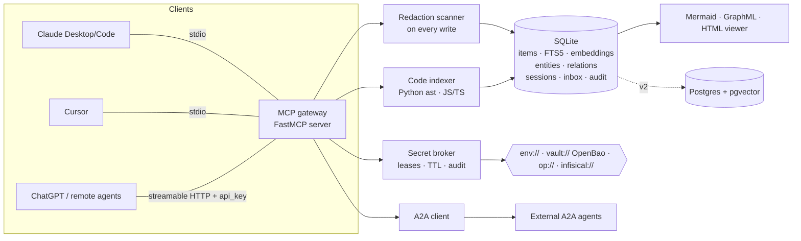

# Commons — unified cross-AI memory

**One MCP server every AI can plug into** — Claude Desktop / Claude Code, Cursor, ChatGPT (MCP connectors),
and your own agents — to **remember everything, pick up each other's work, ask why another agent did something,
and search it all many ways**, while staying fast, token-frugal and safe with credentials.

- 🧠 **Shared memory**: `remember`, hybrid `search` (FTS5 keyword + vector + filters), `expand`, `timeline`
- 🪙 **Token-budgeted**: search returns one-line summaries with ids inside `max_tokens`; `expand(id)` on demand
- 🕸️ **One graph**: memories, projects, code symbols, sessions, agents and tasks share stable ids → `graph_query`, `neighbors`, Mermaid/GraphML/HTML export
- 🧩 **Code index**: Python (ast) + JS/TS → files, symbols, imports, calls → `code_symbols`, `code_impact`
- 🔁 **Handoffs**: `session_start` → `checkpoint` → `handoff` (structured packet) → `resume` by any other AI
- 🤔 **Reasoning log**: `record_decision(what, why, alternatives)` and `why(query|id)`
- 🤝 **Agents**: registry, per-agent API keys, `ask_agent` / `delegate` via a shared inbox, A2A client stub
- 🔐 **Secrets by reference only**: `env://`, `vault://`, `op://` refs; short-lived audited leases; redaction scanner on every write
- ⚠️ **Multi-writer safety**: write provenance, contradicting-fact detection & resolution

Single dependency (`mcp`), SQLite storage, zero services to run.

## Quickstart

```bash
# install (pick one)
uv tool install git+https://github.com/Neoo-Blue/commons-memory
pip install git+https://github.com/Neoo-Blue/commons-memory

commons init                      # creates ~/.commons/commons.db, prints client config snippets
commons index . --project myapp   # index a repo into the graph
commons remember "Payments use Stripe webhooks; retries are idempotent" --project myapp
commons search "stripe retries"
commons export-graph --format html -o graph.html   # open in a browser
commons serve                     # MCP over stdio
commons serve --transport http --port 8765         # MCP streamable HTTP at http://127.0.0.1:8765/mcp
```

Optional better embeddings: `pip install "commons-memory[embed] @ git+https://github.com/Neoo-Blue/commons-memory"` and set
`COMMONS_EMBEDDER=fastembed` (BAAI/bge-small, local ONNX). Default is a dependency-free hashing embedder;
`COMMONS_EMBEDDER=none` gives keyword-only.

## Connect your AIs

All clients should point at the **same `COMMONS_DB`** (stdio) or the same HTTP server, so they share memory.

**Claude Desktop** — `claude_desktop_config.json`
```json
{
  "mcpServers": {
    "commons": {
      "command": "commons",
      "args": ["serve"],
      "env": { "COMMONS_AGENT": "claude-desktop", "COMMONS_DB": "/Users/you/.commons/commons.db" }
    }
  }
}
```

**Claude Code**
```bash
claude mcp add commons -e COMMONS_AGENT=claude-code -- commons serve
```

**Cursor** — `.cursor/mcp.json` (or `~/.cursor/mcp.json`)
```json
{
  "mcpServers": {
    "commons": { "command": "commons", "args": ["serve"], "env": { "COMMONS_AGENT": "cursor" } }
  }
}
```

**Generic / remote (streamable HTTP)** — ChatGPT connectors, custom agents, other MCP clients
```bash
commons register-agent my-agent --vendor acme     # prints an api_key (shown once)
commons serve --transport http --host 0.0.0.0 --port 8765
```
```json
{ "mcpServers": { "commons": { "url": "http://your-host:8765/mcp" } } }
```
Over HTTP, writes require the agent's `api_key` argument (set `COMMONS_REQUIRE_KEYS=0` or `--no-auth` for local dev).
For stdio you can set `COMMONS_API_KEY` in the client env instead of passing it per call. Put the HTTP server
behind TLS (reverse proxy) before exposing it beyond localhost.

## Tools

| Area | Tools |
|---|---|
| Memory | `remember`, `search`, `expand`, `timeline`, `conflicts` |
| Graph | `graph_query`, `neighbors`, `export_graph` (mermaid / graphml / json / html) |
| Code | `index_code`, `code_symbols`, `code_impact` |
| Sessions | `session_start`, `checkpoint`, `handoff`, `resume` |
| Reasoning | `record_decision`, `why` |
| Agents | `register_agent`, `list_agents`, `ask_agent`, `delegate`, `inbox`, `respond_task`, `get_task`, `a2a_send` |
| Secrets | `secret_register`, `secret_list`, `secret_request`, `secret_revoke`, `secret_audit` |
| Misc | `stats` |

**Token-saving search output** (default `format="text"`):
```
mem_01a12d109ea4… [memory] 2026-10-11 commons-memory/claude-desktop: Search uses reciprocal rank fusion of FTS5 bm25 and vector cosine
dec_01a12d109eb3… [decision] 2026-10-11 commons-memory/claude-desktop: SQLite as default store — because zero-ops, single file
… 14 more (raise max_tokens/limit or refine filters)
```
Filters: `project`, `agent_filter`, `tags`, `kinds`, `entity` (name or id), `since`/`until` (ISO or `7d`, `12h`), `mode` = `hybrid|keyword|semantic`.

**Handoff packet** (what `resume` returns to the next AI):
```json
{"goal": "...", "summary": "...", "state": "...", "decisions": [], "next_steps": [], "open_questions": [],
 "relevant_ids": ["dec_…", "ent_…"], "from_agent": "claude-code", "to_agent": "cursor", "project": "myapp"}
```

## Architecture



- **Stable ids** (`mem_`, `dec_`, `fct_`, `hof_`, `chk_`, `ent_`, `prj_`, `ses_`, `agt_`, `tsk_`, `lea_`) are time-sortable and
  global; a `relations` table links any id to any id (`in_project`, `authored_by`, `in_session`, `mentions`,
  `related_to`, `defines`, `imports`, `calls`, `contradicts`, `assigned_to`, …), so "decision X ↔ function Y ↔ session S ↔ agent A" is one query.
- **Search** fuses FTS5 BM25 and vector cosine with reciprocal-rank fusion, then packs results until `max_tokens`.
- **Storage interface** (`backends.py`) lets a Postgres/pgvector adapter slot in (DDL included; implementation is v2).

## Security model

1. **No raw secrets in memory.** Every write (memories, titles, metadata, session state, handoffs, inbox tasks,
   A2A messages) passes a gitleaks-style scanner (private keys, AWS/GitHub/Slack/OpenAI/Stripe/Google keys, JWTs, bearer
   tokens, `password=`-style assignments, credentials in URLs) and is stored as `[REDACTED:<kind>]`.
2. **References, not values.** Secrets are registered as `env://NAME`, `vault://mount/path#key` (Vault/OpenBao KV v2),
   `op://vault/item/field` (1Password CLI) or `infisical://…` (adapter interface). Refs can be limited to named agents and a max TTL.
3. **Short-lived, agent-bound leases.** `secret_request` returns a lease handle (default 5 min, max 1 h) — never the value.
   The value is resolved only by `commons secret-exec <lease> --as VAR -- <cmd>`, which injects it into a child
   process environment, so it never enters a model's context. Leases are bound to the requesting agent, expire, and can be revoked
   individually, per agent, or per ref.
4. **Audit.** Register / lease / resolve / deny / revoke / redaction events go to an append-only audit table (no values).
5. **Identity & provenance.** Agents get API keys (only SHA-256 hashes are stored). Every record carries `agent_id` and an
   `authenticated` flag. HTTP mode requires keys for writes by default.
6. **Poisoning & contradictions.** Facts with `subject/predicate/value` are checked against existing facts; contradictions are flagged
   (`⚠conflict` in search), linked with `contradicts` edges, and resolved via `conflicts(resolve_id, keep_id)` which supersedes the loser.

Threats not yet covered in v1: per-project ACLs/row-level security, OAuth 2.1 for HTTP, rate limiting, encryption at rest
(use full-disk encryption or SQLCipher), egress allow-lists for A2A.

## Comparison & credits

Commons composes ideas from excellent projects — use them directly if they fit you better:

| Project | What it does great | How Commons relates |
|---|---|---|
| [Graphiti / Zep](https://github.com/getzep/graphiti) | Bi-temporal knowledge graph, hybrid retrieval | Inspired conflict/supersede model; Graphiti adapter is on the roadmap |
| [mem0 / OpenMemory](https://github.com/mem0ai/mem0) | Fact extraction, cross-client MCP memory | Similar "one memory for all clients" goal; Commons adds code graph, handoffs, reasoning, secrets |
| [Cognee](https://github.com/topoteretes/cognee) | Document + code knowledge graphs (ECL pipelines) | Commons is a lighter single-file store; Cognee is richer for doc ingestion |
| [Serena](https://github.com/oraios/serena) | LSP-powered semantic code tools for agents | Commons' code index is static & cheap; Serena-style live LSP lookups planned |
| [A2A protocol](https://github.com/a2aproject/A2A) | Agent-to-agent messaging standard | Commons ships an A2A client stub; full A2A server endpoint planned |
| [basic-memory](https://github.com/basicmachines-co/basic-memory), [MCP memory server](https://github.com/modelcontextprotocol/servers) | Human-readable / minimal MCP memory | Markdown export planned for human audit |

## Roadmap

- **v1 (this release)**: everything above on SQLite; stdio + HTTP MCP; CLI; tests + CI.
- **v2**: Postgres + pgvector backend; Graphiti adapter; tree-sitter for more languages (Go, Rust, Java); LLM-generated
  rolling session summaries and ≤200-token entity cards; Markdown export/import (basic-memory compatible); full A2A server endpoint;
  Infisical adapter and Vault dynamic-secret engines; OAuth 2.1 for HTTP; per-project ACLs; OpenTelemetry traces.
- **v3**: background consolidation/dedup, trust scores per agent, web UI.

## Development

```bash
uv venv && uv pip install -e ".[dev]" && uv run pytest -q
```

MIT licensed.
