# Commons — one shared brain for all your AIs

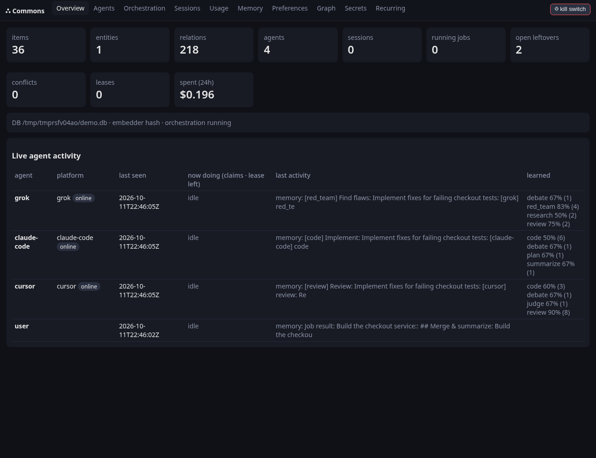

**Commons is a memory + coordination hub that every AI agent installs as a skill and connects to over MCP** —
Claude Code, Claude Desktop, Cursor, Codex, ChatGPT, Grok, Muse and custom agents. They share memory, pick up each
other's unfinished work, learn how *you* like things done, and split big tasks between them with debate, review
and verification gates. A local dashboard shows what every AI is doing and what it costs.

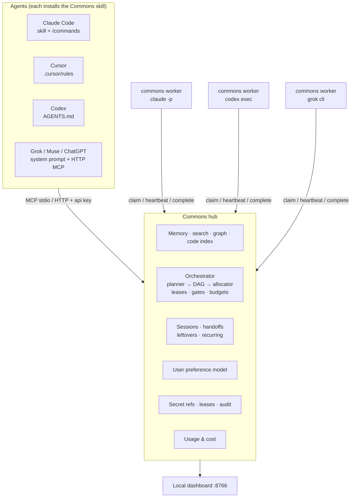

**v0.2 adds:** installable skills for every platform · capability profiles that learn from outcomes · distributed
orchestration (DAGs, debate, cross-review, consensus, plan→execute→verify, quality gates, budgets, retries) · leftovers and
recurring tasks that carry unfinished work forward · user preference learning injected into every task · headless
`commons worker` for CLI agents · a local web dashboard · usage/cost tracking · kill switch, backups and hardening.
See [FLAWS_AND_GAPS.md](FLAWS_AND_GAPS.md) for known risks.

v0.1 features remain: shared memory with hybrid search and token-budgeted results, one graph across memory/code/sessions,
code indexing, handoffs, reasoning log, agent inbox, secret references, conflict detection.

## v0.5: production hardening (Postgres, auth, ACLs, trust, escalation, A2A server)

v0.5 closes the open items from `FLAWS_AND_GAPS.md`. That file now separates what is fixed from what is still open and says why.

| Feature | How |
|---|---|
| Postgres + pgvector | `pip install commons-memory[postgres]`, `COMMONS_DB=postgresql://user@host/db`. Run `commons migrate-postgres DSN` to move an existing SQLite DB |
| Encryption at rest | `pip install commons-memory[encryption]`, `COMMONS_DB_KEY=...` (SQLCipher). For encrypted backups, `COMMONS_BACKUP_KEY=...` |
| HTTP auth for reads and writes | Agent API keys or OAuth 2.1 bearer tokens (`COMMONS_OAUTH_ISSUER`, `COMMONS_OAUTH_INTROSPECT_URL`). Rate limit with `COMMONS_RATE_PER_MIN` |
| Per-project ACLs | `commons acl grant PROJECT AGENT --role read|write|admin` |
| Trust scores | `commons trust list|set|unset`. Trust weights search and KB digests (`COMMONS_KB_MIN_TRUST`) |
| Nothing waits forever | Escalation ladder: reassign, then the distributor model, then notify you (`commons notifications`, `COMMONS_NOTIFY_WEBHOOK`) |
| Missed schedules | `schedule(..., catchup="skip|once|all", max_catchup=N)` |
| Background maintenance | In-process thread in `serve`/`dashboard` (`COMMONS_BACKGROUND=1|full|0`): KB rebuilds, librarian, escalation, retention, backups |
| Retention / backups | `commons prune`, `commons backup [--encrypt]`, `commons dump` / `commons import-memory` |
| A2A server | `POST /a2a` (send, stream, get, cancel, resubscribe), `/.well-known/agent-card.json`. Client: `commons a2a send URL "text" --wait` |
| Code graph | `pip install commons-memory[code]` turns on tree-sitter JS/TS. Call targets are resolved through imports and scope |
| Dashboard | `--tls-self-signed` or `--tls-cert/--tls-key`, SSE live updates, `commons dashboard-user add NAME --role viewer` |
| Secrets | Real Infisical adapter, `vault-dyn://` dynamic credentials revoked with the lease, entropy-based redaction |
| MCP hub | Pooled persistent upstream sessions, per-agent credentials, OAuth client-credentials/refresh for upstreams, `verify-catalog` |
| Tokens / tracing | Exact counts through tiktoken and the Anthropic/Gemini count APIs. OpenTelemetry with `[otel]` and `COMMONS_OTEL=1` |

Install everything with `pip install "commons-memory[all]"`. Workers: see `docs/workers.md` for the flags checked against each vendor's docs.

## v0.4: shared skill pool, research, model routing, org chart, librarian, MCP hub

| | |
|---|---|
| 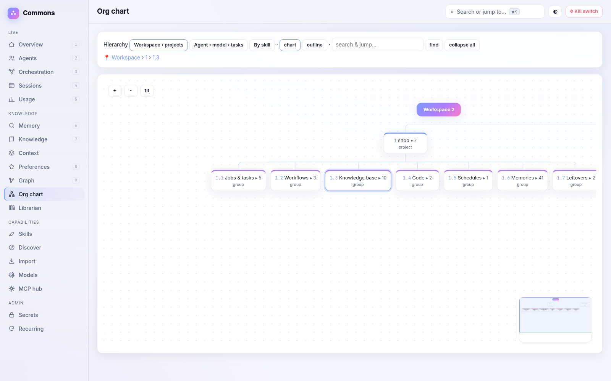 | 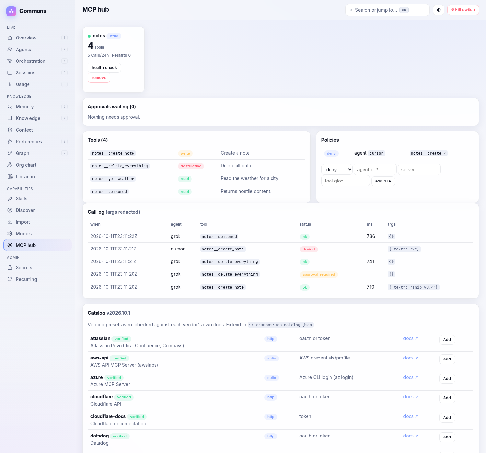 |
| 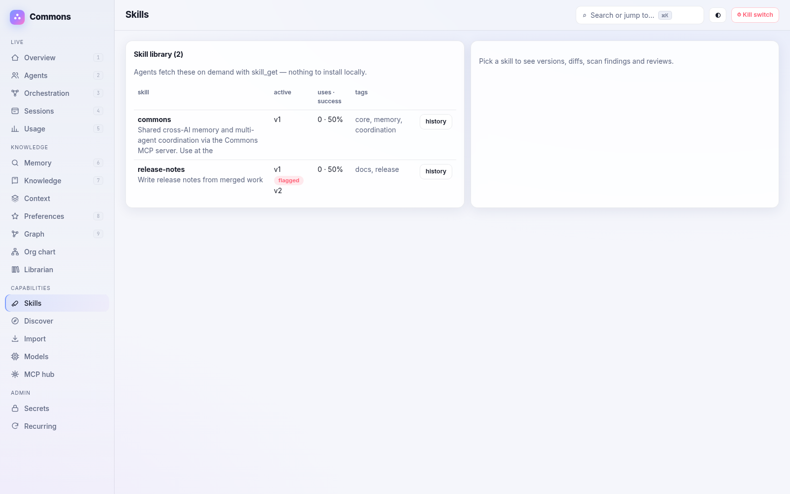 | 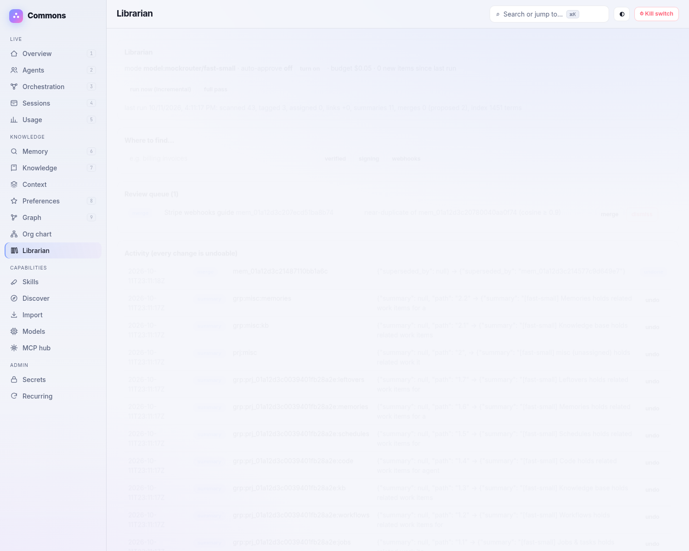 |

**Skill pool.** Commons is now the skill registry. Agents install only a tiny *bootstrap* skill and fetch everything
else on demand: `skill_list / skill_search / skill_get` (token-budgeted), `skill_publish / skill_update / skill_fork`,
`skill_rate`, `skill_rollback`, `skill_history` (full versions + diffs). Every version passes a gate before it can become
active: secret redaction, a prompt-injection / exfiltration scanner, then review by another agent, a configured
`skill_reviewer` model, or you (no self-review). Usage and success are tracked per agent and model; skills are graph
nodes (`version_of`, `used_by`, `authored_by`, `depends_on`, `forked_from`).

**Skill discovery and import.** `commons skills discover` (also run daily by `commons scheduler`) uses the GitHub REST
API, authenticated with a secret ref (`commons skills configure --token-ref env://GITHUB_TOKEN`), to find public
SKILL.md skills, Claude Code plugins and skill repos, AGENTS.md / Cursor-rules collections and awesome-lists. It
respects rate limits and does no HTML scraping. Results are ranked as **hot/trending** (star velocity over 1d/7d, from
daily snapshots) and **all-time popular** (stars and forks). They are stored as a catalog of metadata (source URL,
license, pinned commit), and nothing activates automatically. `commons skills add <id>` or the dashboard's
**Add to pool** imports the pinned version through the gate: a license allow-list, scanning, provenance, and a
mandatory review. Upstream changes show up as new *pending* versions with diffs. `commons skills import` moves skills
already on this machine into the pool, de-duplicating them: `~/.claude/skills`, project `.claude/skills`, Claude Code
plugins, `.cursor/rules`, `AGENTS.md`, `~/.codex` and custom paths. Add `--replace-local` to swap each local copy for a
pointer; the originals are backed up.

**Research.** `research(query)` searches and fetches with a pluggable provider (Brave, Tavily, Exa, SearXNG, or plain
`fetch` of URLs). Keys are secret refs. Pages are extracted to text, redacted and stored as cited `source` memories plus
a research note that feeds the project KB. Results are cached.

**Model providers and routing.** Connect Anthropic, OpenAI, OpenRouter, Google, xAI or a local Ollama with secret refs
only (`commons models add-provider openrouter openrouter --key-ref env://OPENROUTER_API_KEY`). The model registry
records context size, cost, capabilities, learned scores and which agents can run which models, and refreshes itself
from provider APIs to detect **new models**. You choose a **distributor** model (any id, e.g. an Opus-class model
direct or via OpenRouter; nothing is hard-coded) with `set_role_model("distributor", "<provider>/<model>")`. It plans
DAGs, builds the task-type → agent+model routing table, and when a new model appears it benchmarks it with cheap probes
under a $ budget, then proposes a reallocation (or applies it if auto-approve is on). The planner, preference
extractor, KB summarizer, skill reviewer and librarian use this layer when it's configured and heuristics otherwise.
The `@llm` worker mode runs API-only seats. A mock provider powers the tests and demo.

**Org chart.** `tree(root, depth, max_tokens)` and `commons tree` give a layer-by-layer outline with **stable index
paths** (`1.3.2`, `agents/2.1`) that agents can pass back to drill down. The layout is Workspace › Projects › (Jobs &
tasks, Workflows, Sessions, Knowledge base, Code dirs › files › classes › functions, Schedules › runs, Skills, Memories,
Leftovers), with alternate roots *agent › model › tasks* and *by skill*. It exports to Mermaid `flowchart TD` and to a
Markdown outline. The dashboard shows a tidy top-down tree with lazy-loaded, collapsible layers, child counts, hover
cards, breadcrumbs, search-jump-expand, zoom/pan with a minimap, and an outline mode.

**Librarian.** A built-in agent that keeps everything organized. It runs as a configured cheap model (role
`librarian`), as any connected agent claiming `librarian` subtasks (`librarian_run(delegate=true)`), or on heuristics
alone. Incrementally after writes and on the scheduler, within a $ budget, it:
- de-duplicates and merges near-duplicates
- auto-tags and assigns orphans to projects
- repairs graph links
- flags stale or contradicting items
- writes a one-line summary per tree node
- builds a "where to find X" index for `find(query)`, which returns the best few tree paths + ids for a few tokens
- tidies the skill pool

Every change is logged with provenance and can be undone. Merges go to a review queue unless auto-approve is on. Tools:
`librarian_run / status / proposals / approve / undo`, `find`.

**MCP hub.** Commons proxies your upstream MCP servers. Register each server once (stdio command or HTTP/SSE URL);
credentials are secret refs only. You can also import existing Claude Desktop / Cursor / Claude Code configs with
`commons mcp import`; literal keys are **not** copied but turned into `env://` refs. Agents see namespaced tools
(`github__create_issue`) through `mcp_search` (one line each), `mcp_describe` (one schema) and `mcp_call`, so only the
schemas they need cost tokens. On top of that, the hub adds:
- per-agent allow / deny / approve policies per server and tool (globs)
- risk tags (read / write / destructive), with destructive calls needing human approval by default
- per-agent rate limits
- an audit log of every call, with arguments redacted
- usage attribution
- health checks that reconnect or restart servers
- a cache for read-only results

Upstream output is redacted and wrapped in `<untrusted source="mcp:server/tool">` markers.

**MCP catalog.** `commons mcp catalog` and `commons mcp add-preset <id>` (or **Add** in the dashboard) connect major
vendors in one step. The catalog is a versioned data file (`src/commons_memory/data/mcp_catalog.json`). You can extend
it with `~/.commons/mcp_catalog.json`. Each preset declares its transport, endpoint/command, auth type, required secret
refs, default per-tool risk tags and a health check (`tools/list`).

*Verified* presets were checked on 2026-10-11 against each vendor's own docs or official repo, linked in the `docs`
field:
- **Remote endpoints:** GitHub (`api.githubcopilot.com/mcp/`, plus a local Docker image), GitLab (`/api/v4/mcp`),
  Atlassian Rovo (`mcp.atlassian.com/v2/mcp`), Linear, Notion, Slack, Google Gmail / Drive / Calendar (Workspace MCP
  endpoints), Cloudflare API + docs, Stripe, Supabase, Vercel, Sentry, PagerDuty, Datadog, HubSpot, Salesforce
  hosted MCP, Figma.
- **Local servers:** Azure MCP (`@azure/mcp`), AWS API MCP (`awslabs.aws-api-mcp-server`), Shopify Dev MCP, Playwright
  MCP, filesystem reference server.

Zapier is listed as *community/unverified* because its URL is user-specific. Microsoft 365 is omitted because no
official general-purpose server was verified. OAuth-only servers need you to obtain a token once and store it as a
secret ref; Commons does not run interactive OAuth flows yet.

**Dashboard redesign.** The dashboard is dark-first with a light-theme toggle and a CSS-variable design system:
- glassy panels, gradient accents and a sidebar with icons
- a **⌘K / Ctrl-K command palette** for pages, librarian locations and memory
- keyboard shortcuts: `1–9`, `[ ]`, `t`, `r`, `+/-`, `?`
- a live activity feed, animated per-agent status dots, SVG sparklines and stacked daily cost bars
- toasts, empty states, focus rings, `prefers-reduced-motion` support and a mobile layout

It needs no build step and has no dependencies. 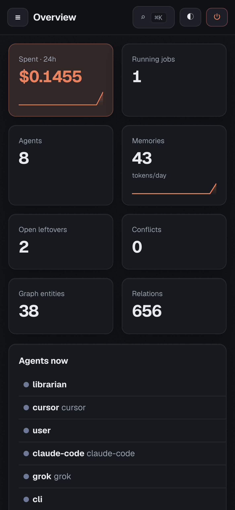

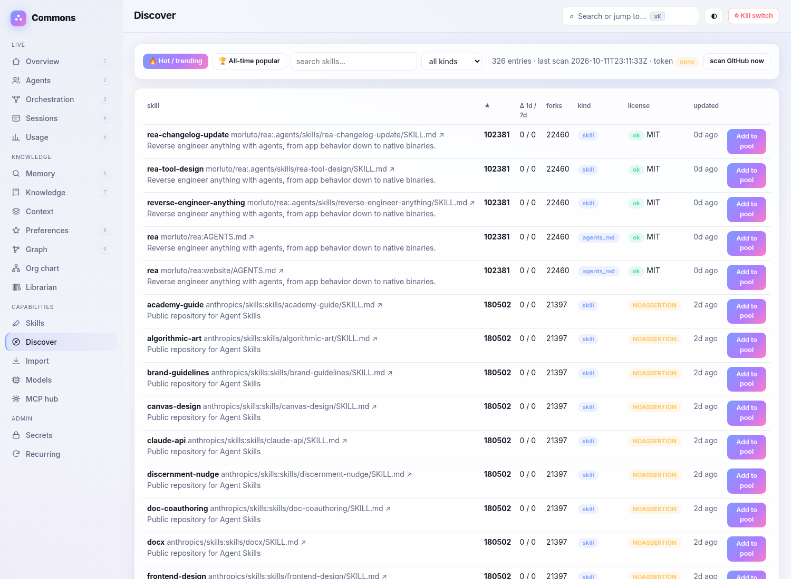
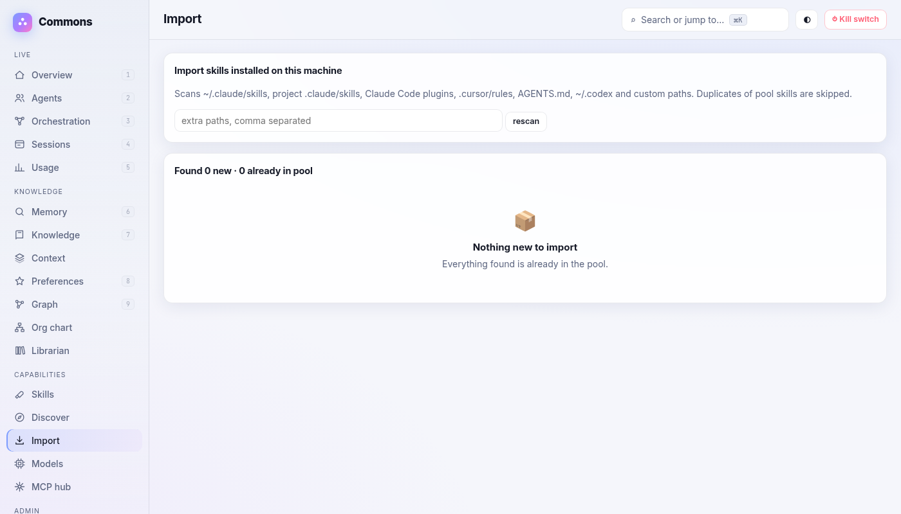

### Shared context store (handoffs without re-paying tokens)

Agents snapshot their working context into a **context pack**: L0 gist (one paragraph), L1 brief (goal / state /
decisions / open threads / next steps), L2 detailed titled sections (notes, file excerpts), L3 raw refs (ids, paths +
hashes, URLs; never inlined). Sections are content-addressed (sha256) blobs, so identical text is stored once across
packs and agents, and `delta=true` snapshots send only changed sections. A handoff or `submit_task(context_pack=...)`
passes the **pack id**; each subtask receives only the L1 within a token budget and can `context_load(pack, "L2",
sections=[...])` or L3 refs if it needs them.

Prompt caching: the L0+L1 block is rendered as a byte-stable, timestamp-free **prefix** and placed first in worker
prompts. `ProviderLayer.chat(..., cache_prefix=...)` sends it as an Anthropic `cache_control: ephemeral` system block,
or as the leading message for OpenAI/OpenRouter/xAI (they cache identical prefixes automatically). Cached input tokens
(`cache_read_input_tokens` / `prompt_tokens_details.cached_tokens`) go into `usage.cached_tokens` and cost estimates
at about 10% of the input price. Token counts are estimated per model: tiktoken for OpenAI models when installed,
otherwise a calibrated chars-per-token ratio. `context_fit(pack, model)` picks the deepest layer that fits the receiving
model's context window (from the model registry, or known defaults).

Tools: `context_save / context_load / context_diff / context_fit`. CLI: `commons context list|load|diff|fit|savings`.
The dashboard **Context** page shows packs, per-layer token sizes, new vs reused bytes, delta diffs, tokens saved by
layering, and provider cache hits.

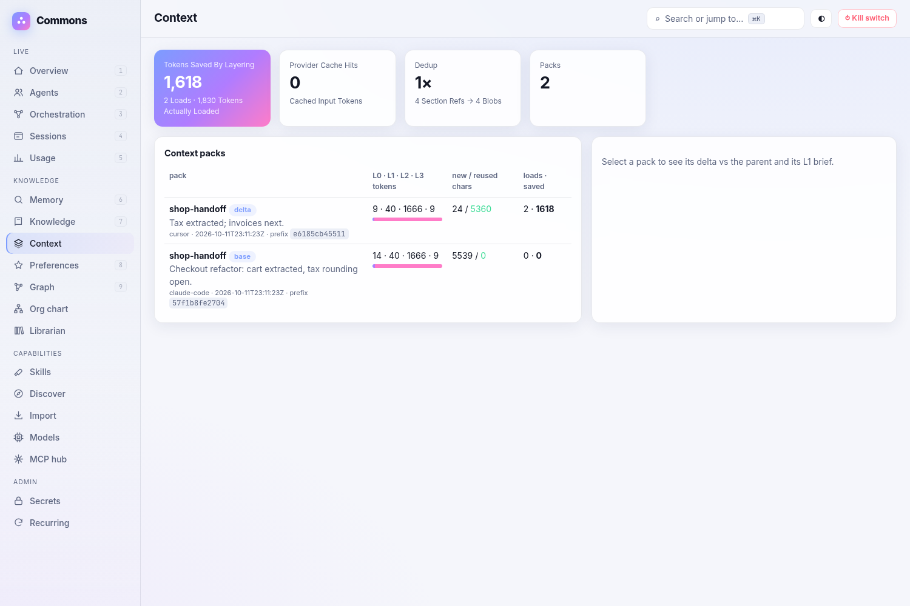

## v0.3: everything is a graph, and every project has a living knowledge base

**Graph everything.** Schedules and their runs (`run_of`), decisions (`decided_by`, `about` code/entities, `in_project`,
`in_session`), preferences (`applies_to` project / task type / global, `learned_from` agent), workflow patterns
(`uses_pattern`), debate rounds (`argues_in`, `judges`), review verdicts (`reviews`, `approves`/`rejects`), subtask DAG edges
(`depends_on`, `has_type`, `executed_by`), leftovers (`for_schedule`, `carries`), usage (`billed_to` job/project, `spent_by`
agent, `used_model`), leases and secret references (`lease_of`, `held_by`; references only, never values) are linked on write.
`commons graph rebuild` (or the `graph_rebuild` tool) backfills older databases and is idempotent.
Scoped views: `graph_view(scope=project|job|workflow|schedule|node, id)`, `commons graph view --scope job --id job_… --format html`,
and the dashboard Graph page has project, job, workflow and schedule filters plus depth.

**Automatic knowledge base.** Each project, plus `misc` for unassigned memories (auto-clustered into `misc/<topic>`), gets a
wiki with these sections: overview · key decisions & rationale · architecture & components (from the code graph) · glossary &
entities · references (URLs, repos, files) · how-tos & runbooks · people & agents (with spend) · open questions & leftovers ·
timeline · preferences that apply. **Every statement cites its source record ids** (`[dec_…]`, `[mem_…]`, `[ent_…]`).

- Writes mark a bucket dirty. It is rebuilt on read, by `commons scheduler`, or by `commons kb build`, at most every
  `COMMONS_KB_DEBOUNCE` seconds (default 10).
- Extractive summaries by default. `COMMONS_KB_SUMMARIZER="<cmd>"` pipes each section through your LLM; citations are kept.
- MCP tools: `kb_get(project, section, max_tokens)`, `kb_search`, `kb_list`, `kb_refresh`. Every `pickup` and subtask packet
  includes a compact KB digest (~150 tokens).
- `commons kb export ./vault` writes an Obsidian-friendly vault: `<project>/index.md`, one page per section with
  `[[records/<id>]]` wikilinks, and `records/<id>.md` with "Cited in" backlinks.
- Dashboard **Knowledge** page: buckets, section tabs, and clickable citations that open the record, its graph neighbourhood and
  every other KB page that cites it.

| Knowledge base | Graph scoped to a workflow |
|---|---|
| 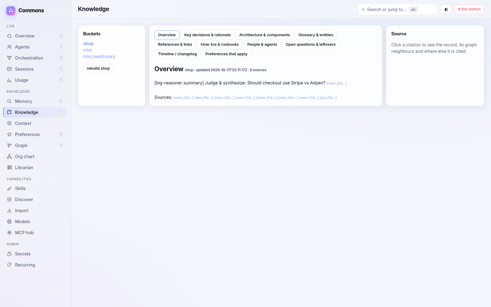 | 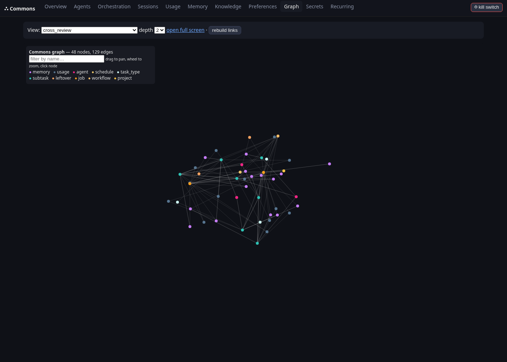 |

## Multi-agent quickstart: one big task across Claude Code + Grok + Cursor

```bash
uv tool install git+https://github.com/Neoo-Blue/commons-memory      # or: pip install git+...
commons init

# 1) connect each agent: registers identity + api key (~/.commons/agents/<name>.key) + capability profile,
#    and installs the skill/rules/MCP config for its platform
commons connect claude-code --platform claude-code --expertise code:0.9,plan:0.8,summarize:0.7 --cost 4
commons connect grok        --platform grok        --expertise debate:0.9,red_team:0.9,research:0.8 --cost 3
commons connect cursor      --platform cursor      --expertise review:0.9,test:0.8,code:0.7 --cost 2

# 2) submit one big task: bullet items become parallel parts, each gated by a review from a different agent
commons submit "Build the checkout service:
- cart API endpoints
- research payment providers
- order confirmation email" --project shop --max-cost 5

# 3) give each platform a headless seat (agents usually aren't running all the time)
commons worker --agent claude-code --preset claude --model claude-sonnet &
commons worker --agent cursor --preset cursor --model gpt-4o &
commons worker --agent grok --cmd "grok-cli --stdin" --model grok-4 &      # any CLI that reads a prompt on stdin

# 4) watch it run
commons dashboard            # http://127.0.0.1:8766
commons status               # DAGs as text
```

Interactive agents use the same tools: in Claude Code, `/commons-checkin` calls `pickup` (ready subtasks, leftovers,
your preferences); `/commons-delegate <task>` submits work; `/commons-handoff` hands off.

Try it without any real AI: `python examples/demo_multi_agent.py` runs three simulated agents (real `commons worker`
processes with a mock CLI) through a decomposed task, a debate, review rejections and rework, a leftover carried into
the next recurring run, and a learned preference applied ([sample output](docs/demo-output.txt)).

## Install the skill on each platform

| Platform | Command | What it writes |
|---|---|---|
| Claude Code | `commons install-skill claude-code [--scope user]` | `.claude/skills/commons/SKILL.md`, `/commons-*` slash commands, plugin manifest, `.mcp.json` |
| Claude Desktop | `commons install-skill claude-desktop` | MCP entry in `claude_desktop_config.json` (+ SKILL.md to upload) |
| Cursor | `commons install-skill cursor` | `.cursor/rules/commons.mdc` (always-on rule) + `.cursor/mcp.json` |
| Codex / others reading AGENTS.md | `commons install-skill codex` | `AGENTS.md` section + `~/.codex/config.toml` MCP server |
| ChatGPT / Grok / Muse / generic | `commons install-skill grok` | `commons-grok-prompt.md` system prompt; connect via HTTP MCP |
| Everything | `commons install-skill all` | all of the above |

The agent-agnostic skill ([`SKILL.md`](src/commons_memory/skills/SKILL.md), Anthropic Agent Skills format) teaches the
loop: **check in** (`pickup`, `resume`) → **pull context** (`search`/`expand`/`why`) → **claim** (`claim_subtask`) →
**record** (`record_decision`, `remember`, `observe_preference`) → **hand off** (`handoff`, `add_leftover`) → **report** (`report_usage`).

## Orchestration

| Pattern | DAG | Quality gate |
|---|---|---|
| `plan_execute_verify` | plan → execute → verify | execute is done only after verify approves |
| `cross_review` | code → review + red_team | code is done only after **both** approve (author can never review own work) |
| `debate` | N debaters (distinct agents) → judge | judge's synthesis is stored as a decision |
| `consensus` | N voters → automatic tally | majority of `VERDICT: approve` |
| `parallel` | plan → parts (each gated by review) → merge/summary | each part |
| explicit / LLM | `dag=[{key,type,deps,gates}]` or `pattern="llm"` with `COMMONS_PLANNER_CMD` | as declared |

- **Allocation**: expertise × learned success rate (Beta-smoothed per agent and task type) − load − cost + speed;
  availability and `max_concurrent` respected; siblings in debates and votes spread across agents.
- **Execution**: atomic claims (no duplicate work), leases + `heartbeat`, expired leases → retry on another agent,
  `max_attempts`, rejected gates → rework with the reviewer's feedback appended, the author's score drops.
- **Budgets**: `budget={"tokens","cost","seconds"}` per job (claims stop → `budget_exceeded`), `COMMONS_DAILY_COST_CAP`
  auto-pauses everything, `kill_switch` / `commons pause` / dashboard button, `cancel_job`.
- **Merging**: final results are merged into the job and saved to memory; judge outputs become decisions.

## Continuity, leftovers and recurring work

- `handoff` next_steps/open_questions and `LEFTOVER:` lines from workers become **leftovers** (de-duplicated).
- `schedule_recurring(name, cron, task)` / `commons schedule`; `commons scheduler` (or system cron + `--once`) starts due runs;
  **open leftovers from earlier runs become subtasks of the next run**.
- `pickup` gives each agent ready subtasks, its inbox and leftovers ranked by priority × its expertise, plus your preferences.

## Your preferences, learned once

`observe_preference`, or automatically from corrections (`extract_preferences("No, use tabs instead…")`, rejected
review feedback, workers' `PREFERENCE:` lines). Each preference has confidence, source, evidence, scope
(global / project / task type) and decays over time (half-life `COMMONS_PREF_HALF_LIFE_DAYS`, default 120) unless confirmed or
seen again. Relevant preferences are **injected into every `pickup` and subtask packet**, within a token budget.
Privacy: `commons prefs list|add|confirm|forget|forget-all|export` or the dashboard's Preferences page. Plug in an
LLM extractor with `COMMONS_PREF_EXTRACTOR="<cmd>"`.

## Workers (headless execution)

`commons worker --agent X (--preset claude|codex|cursor|gemini | --cmd "<shell template>")` loops: claim → render a
prompt (brief, upstream results fenced as untrusted, preferences, protocol) → run the CLI with the prompt on stdin
(also `{prompt_file}`, `$COMMONS_SUBTASK_ID`, `$COMMONS_TASK_TYPE`) → heartbeat while running → parse
`VERDICT:` / `LEFTOVER:` / `PREFERENCE:` / `TOKENS:` → complete (a non-zero exit means the attempt failed and is retried).
Use `--url http://hub:8765/mcp --api-key …` to work against a remote hub. See [docs/workers.md](docs/workers.md).

## Dashboard

`commons dashboard` (or `commons serve --dashboard`) → http://127.0.0.1:8766. It binds to localhost only; set `--token`
or `COMMONS_DASHBOARD_TOKEN` to bind elsewhere. With `serve --transport http --host <ip> --dashboard`, the dashboard follows
`--host` (since 0.5.1); override with `--dashboard-host`. Pages: live agent activity (claims, lease countdowns, last seen,
learned scores), sessions and leftovers, orchestration DAGs with debate transcripts and gate verdicts, cost and usage charts by
agent, project, job, model and day, a memory browser with conflict resolution, editable preferences, an interactive graph,
secret references, leases and audit log (never values), recurring schedules, and a kill switch. Prometheus metrics are at `/metrics`.


Costs come from `report_usage` (agents) and workers, priced with a configurable table (`COMMONS_PRICES` or
`~/.commons/prices.json`, `{"model-prefix": [usd_per_M_in, usd_per_M_out]}`).

## Basics (v0.1)

## Quickstart

```bash
# install (pick one)
uv tool install git+https://github.com/Neoo-Blue/commons-memory
pip install git+https://github.com/Neoo-Blue/commons-memory

commons init                      # creates ~/.commons/commons.db, prints client config snippets
commons index . --project myapp   # index a repo into the graph
commons remember "Payments use Stripe webhooks; retries are idempotent" --project myapp
commons search "stripe retries"
commons export-graph --format html -o graph.html   # open in a browser
commons serve                     # MCP over stdio
commons serve --transport http --port 8765         # MCP streamable HTTP at http://127.0.0.1:8765/mcp
```

Optional better embeddings: `pip install "commons-memory[embed] @ git+https://github.com/Neoo-Blue/commons-memory"` and set
`COMMONS_EMBEDDER=fastembed` (BAAI/bge-small, local ONNX). Default is a dependency-free hashing embedder;
`COMMONS_EMBEDDER=none` gives keyword-only.

## Connect your AIs

All clients should point at the **same `COMMONS_DB`** (stdio) or the same HTTP server, so they share memory.

**Claude Desktop** — `claude_desktop_config.json`
```json
{
  "mcpServers": {
    "commons": {
      "command": "commons",
      "args": ["serve"],
      "env": { "COMMONS_AGENT": "claude-desktop", "COMMONS_DB": "/Users/you/.commons/commons.db" }
    }
  }
}
```

**Claude Code**
```bash
claude mcp add commons -e COMMONS_AGENT=claude-code -- commons serve
```

**Cursor** — `.cursor/mcp.json` (or `~/.cursor/mcp.json`)
```json
{
  "mcpServers": {
    "commons": { "command": "commons", "args": ["serve"], "env": { "COMMONS_AGENT": "cursor" } }
  }
}
```

**Generic / remote (streamable HTTP)** — ChatGPT connectors, custom agents, other MCP clients
```bash
commons register-agent my-agent --vendor acme     # prints an api_key (shown once)
commons serve --transport http --host 0.0.0.0 --port 8765
```
```json
{ "mcpServers": { "commons": { "url": "http://your-host:8765/mcp" } } }
```
Over HTTP, writes require the agent's `api_key` argument (set `COMMONS_REQUIRE_KEYS=0` or `--no-auth` for local dev).
For stdio you can set `COMMONS_API_KEY` in the client env instead of passing it per call. Put the HTTP server
behind TLS (reverse proxy) before exposing it beyond localhost.

## Tools

| Area | Tools |
|---|---|
| Memory | `remember`, `search`, `expand`, `timeline`, `conflicts` |
| Graph | `graph_query`, `neighbors`, `export_graph` (mermaid / graphml / json / html) |
| Code | `index_code`, `code_symbols`, `code_impact` |
| Sessions | `session_start`, `checkpoint`, `handoff`, `resume` |
| Reasoning | `record_decision`, `why` |
| Agents | `register_agent`, `list_agents`, `ask_agent`, `delegate`, `inbox`, `respond_task`, `get_task`, `a2a_send` |
| Secrets | `secret_register`, `secret_list`, `secret_request`, `secret_revoke`, `secret_audit` |
| Profiles | `set_profile`, `get_profile`, `rate_agent` |
| Orchestration | `submit_task`, `job_status`, `claim_subtask`, `heartbeat`, `complete_subtask`, `cancel_job`, `kill_switch` |
| Continuity | `pickup`, `add_leftover`, `resolve_leftover`, `list_leftovers`, `schedule_recurring`, `run_recurring`, `list_recurring` |
| Preferences | `observe_preference`, `extract_preferences`, `get_preferences`, `confirm_preference`, `forget_preference` |
| Usage | `report_usage`, `usage_summary` |
| Knowledge base | `kb_get`, `kb_search`, `kb_list`, `kb_refresh` |
| Graph views | `graph_view`, `graph_rebuild` |
| Skill pool | `skill_list`, `skill_search`, `skill_get`, `skill_publish`, `skill_update`, `skill_review`, `skill_history`, `skill_rollback`, `skill_rate`, `skill_fork`, `skill_catalog`, `skill_catalog_add` |
| Research | `research` |
| Models | `provider_add`, `models_refresh`, `models_list`, `agent_models`, `set_role_model`, `routing_table`, `models_probe`, `routing_proposals` |
| Org chart | `tree`, `tree_find` |
| Librarian | `find`, `librarian_run`, `librarian_status`, `librarian_proposals`, `librarian_approve`, `librarian_undo` |
| MCP hub | `mcp_servers`, `mcp_search`, `mcp_describe`, `mcp_call` |
| Misc | `stats` |

**Token-saving search output** (default `format="text"`):
```
mem_01a12d109ea4… [memory] 2026-10-11 commons-memory/claude-desktop: Search uses reciprocal rank fusion of FTS5 bm25 and vector cosine
dec_01a12d109eb3… [decision] 2026-10-11 commons-memory/claude-desktop: SQLite as default store — because zero-ops, single file
… 14 more (raise max_tokens/limit or refine filters)
```
Filters: `project`, `agent_filter`, `tags`, `kinds`, `entity` (name or id), `since`/`until` (ISO or `7d`, `12h`), `mode` = `hybrid|keyword|semantic`.

**Handoff packet** (what `resume` returns to the next AI):
```json
{"goal": "...", "summary": "...", "state": "...", "decisions": [], "next_steps": [], "open_questions": [],
 "relevant_ids": ["dec_…", "ent_…"], "from_agent": "claude-code", "to_agent": "cursor", "project": "myapp"}
```

## Architecture

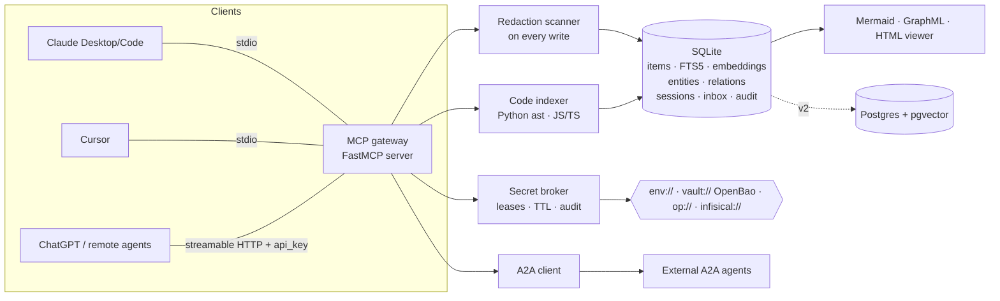

- **Stable ids** (`mem_`, `dec_`, `fct_`, `hof_`, `chk_`, `ent_`, `prj_`, `ses_`, `agt_`, `tsk_`, `lea_`) are time-sortable and
  global; a `relations` table links any id to any id (`in_project`, `authored_by`, `in_session`, `mentions`,
  `related_to`, `defines`, `imports`, `calls`, `contradicts`, `assigned_to`, …), so "decision X ↔ function Y ↔ session S ↔ agent A" is one query.
- **Search** fuses FTS5 BM25 and vector cosine with reciprocal-rank fusion, then packs results until `max_tokens`.
- **Storage interface** (`backends.py`) lets a Postgres/pgvector adapter slot in (DDL included; implementation is v2).

## Security model

1. **No raw secrets in memory.** Every write (memories, titles, metadata, session state, handoffs, inbox tasks,
   A2A messages) passes a gitleaks-style scanner (private keys, AWS/GitHub/Slack/OpenAI/Stripe/Google keys, JWTs, bearer
   tokens, `password=`-style assignments, credentials in URLs) and is stored as `[REDACTED:<kind>]`.
2. **References, not values.** Secrets are registered as `env://NAME`, `vault://mount/path#key` (Vault/OpenBao KV v2),
   `op://vault/item/field` (1Password CLI) or `infisical://…` (adapter interface). Refs can be limited to named agents and a max TTL.
3. **Short-lived, agent-bound leases.** `secret_request` returns a lease handle (default 5 min, max 1 h) — never the value.
   The value is resolved only by `commons secret-exec <lease> --as VAR -- <cmd>`, which injects it into a child
   process environment, so it never enters a model's context. Since 0.5.1, the value is also masked as `***` in the child's
   stdout and stderr, so an accidental `echo $VAR` does not leak into a transcript. Use `--no-mask` to opt out. Leases are bound to the requesting agent, expire, and can be revoked
   individually, per agent, or per ref.
4. **Audit.** Register / lease / resolve / deny / revoke / redaction events go to an append-only audit table (no values).
5. **Identity & provenance.** Agents get API keys (only SHA-256 hashes are stored). Every record carries `agent_id` and an
   `authenticated` flag. HTTP mode requires keys for writes by default.
6. **Poisoning & contradictions.** Facts with `subject/predicate/value` are checked against existing facts; contradictions are flagged
   (`⚠conflict` in search), linked with `contradicts` edges, and resolved via `conflicts(resolve_id, keep_id)` which supersedes the loser.

Threats not yet covered in v1: per-project ACLs/row-level security, OAuth 2.1 for HTTP, rate limiting, encryption at rest
(use full-disk encryption or SQLCipher), egress allow-lists for A2A.

## Comparison & credits

Commons composes ideas from excellent projects — use them directly if they fit you better:

| Project | What it does great | How Commons relates |
|---|---|---|
| [Graphiti / Zep](https://github.com/getzep/graphiti) | Bi-temporal knowledge graph, hybrid retrieval | Inspired conflict/supersede model; Graphiti adapter is on the roadmap |
| [mem0 / OpenMemory](https://github.com/mem0ai/mem0) | Fact extraction, cross-client MCP memory | Similar "one memory for all clients" goal; Commons adds code graph, handoffs, reasoning, secrets |
| [Cognee](https://github.com/topoteretes/cognee) | Document + code knowledge graphs (ECL pipelines) | Commons is a lighter single-file store; Cognee is richer for doc ingestion |
| [Serena](https://github.com/oraios/serena) | LSP-powered semantic code tools for agents | Commons' code index is static & cheap; Serena-style live LSP lookups planned |
| [A2A protocol](https://github.com/a2aproject/A2A) | Agent-to-agent messaging standard | Commons ships an A2A client stub; full A2A server endpoint planned |
| [basic-memory](https://github.com/basicmachines-co/basic-memory), [MCP memory server](https://github.com/modelcontextprotocol/servers) | Human-readable / minimal MCP memory | Markdown export planned for human audit |

## Roadmap

- **v0.1**: memory, search, graph, code index, sessions/handoff, reasoning log, inbox, secret refs, CLI.
- **v0.4 (this release)**: shared skill pool with review gate + GitHub skill discovery + local import; research tool;
  model providers, distributor model, routing table, new-model probing; org-chart tree with index paths; librarian agent
  + `find`; MCP hub/aggregator with verified vendor catalog; redesigned dashboard.
- **v0.3**: everything is linked into the graph (+ `graph rebuild` backfill and scoped views); automatic,
  cited, per-project knowledge base with misc topic clustering, Obsidian export, pickup digests and a dashboard KB browser.
- **v0.2**: skills/installers, capability profiles and learning, orchestration patterns and gates, leftovers and
  recurring runs, preference learning, workers, dashboard, usage and cost tracking, kill switch, backup and export.
- **next**: interactive OAuth for upstream MCP servers; persistent upstream sessions (today each call reconnects); LLM-written KB prose by default when a summarizer is configured, embedding-based topic clustering; Postgres + pgvector backend; Graphiti adapter; tree-sitter for more languages; LLM planner, summarizer and preference
  extractor presets; full A2A server endpoint; OAuth 2.1 and per-project ACLs; trust scores weighting memory by provenance;
  OpenTelemetry traces; dashboard live updates over SSE; push notifications to wake agents instead of polling.

## Development

```bash
uv venv && uv pip install -e ".[dev]" && uv run pytest -q
```

MIT licensed.
