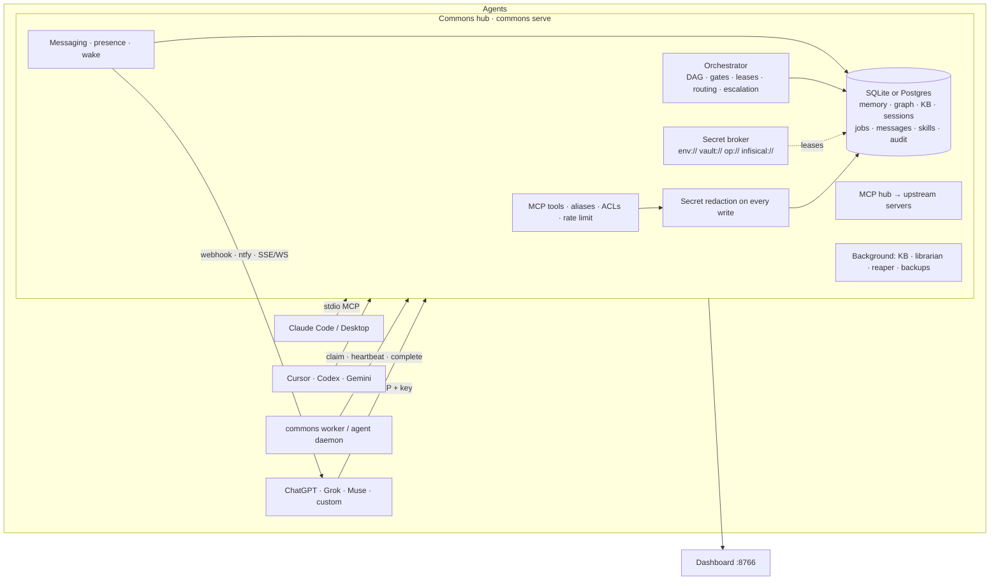

# Commons: one shared brain for all your AIs

**Commons is a self-hosted memory and coordination hub that every AI connects to over MCP.** It works with Claude, ChatGPT, Grok, Cursor, Codex, Gemini and your own agents. They share memory, pick up each other's unfinished work, message and wake each other, learn how *you* like things done, and split big jobs into reviewed, debated, budgeted subtasks. One SQLite file (or Postgres) holds it all. A dashboard shows who is doing what and what it costs.


```sh
curl -fsSL https://raw.githubusercontent.com/Neoo-Blue/commons-memory/main/install.sh | sh
```
```powershell
irm https://raw.githubusercontent.com/Neoo-Blue/commons-memory/main/install.ps1 | iex     # Windows
```
Docker: see [docs/docker.md](docs/docker.md). Prefer to read it first? `curl -fsSLO https://raw.githubusercontent.com/Neoo-Blue/commons-memory/main/install.sh && less install.sh && sh install.sh`. No-script alternatives: `uvx --from git+https://github.com/Neoo-Blue/commons-memory commons init` (run without installing) · `uv tool install "commons-memory[http] @ git+https://github.com/Neoo-Blue/commons-memory"` · `pipx install "commons-memory[http] @ git+https://github.com/Neoo-Blue/commons-memory"`

## Contents
[Quickstart](#2-minute-quickstart) · [Feature tour](#feature-tour) · [Architecture](#architecture) · [Connect any AI](#connect-any-ai) · [Multi-agent](#multi-agent-in-5-commands) · [Security](#security-model) · [Networking](#networking) · [Configuration](#configuration) · [Troubleshooting](#troubleshooting) · [FAQ](#faq) · [Comparison](#comparison) · [Roadmap](#roadmap) · [Changelog](CHANGELOG.md)

## 2-minute quickstart
```sh
# 1. install (above) — this also runs `commons init` (~/.commons/commons.db)
# 2. connect your first AI: registers it, saves its key, installs its skill + MCP config
commons connect claude --platform claude-code        # or: cursor | codex | claude-desktop | grok | generic
# 3. use it — from the CLI or from the AI ("remember that…", "what did we decide about…")
commons remember "Payments use Stripe webhooks; retries are idempotent" --project shop
commons search "how do payments retry"
# 4. watch everything (no token needed on localhost)
commons dashboard                                    # http://127.0.0.1:8766
```
Connect a second AI the same way and it can see the first one's memory immediately. For other AIs (ChatGPT, Grok, Muse…), paste [the universal prompt](#connect-any-ai).

## Feature tour
| Area | What you get | Learn more |
|---|---|---|
| **Memory & knowledge** | Hybrid search (BM25 + vectors) with token budgets · one graph linking memory, code, sessions, agents · code index (Python, JS/TS) · conflict detection · auto-built, cited knowledge base per project · librarian that tidies and answers `find()` | [docs/tools.md](docs/tools.md) |
| **Continuity** | Sessions, checkpoints, handoffs that resume in another AI · layered context packs (L0 gist → L3 full) so the next AI doesn't re-pay tokens · decisions with rationale and `why()` · leftovers and recurring jobs | [docs/guide.md](docs/guide.md) |
| **Teamwork** | Submit a task and get a DAG: plan → parallel parts → cross-review (author ≠ reviewer) → debate/consensus → merge. Quality gates, budgets, leases with automatic reassignment, an escalation ladder, routing to the right agent + model + effort, multi-project scheduling, task breakdown view | [docs/guide.md](docs/guide.md), [docs/multitasking.md](docs/multitasking.md) |
| **Messaging & wake** | Direct and broadcast messages (at-least-once, threaded), a `/bus/*` shim for existing agent buses, presence, and wake channels (signed webhooks, ntfy, Slack, email, SSE/WS, `commons agent daemon`) | [docs/messaging.md](docs/messaging.md) |
| **Skills & tools** | Shared skill pool with versioning, review gate and rollback · MCP hub that proxies upstream servers with per-agent policy and human approval for destructive tools · research · Commons Drive (versioned shared files; S3, WebDAV, SFTP…) | [docs/drive.md](docs/drive.md) |
| **You** | Preferences learned once and applied by every AI · retro learning from your past Claude/ChatGPT/Codex/Cursor history (review queue) | [docs/retro-learning.md](docs/retro-learning.md) |
| **Operations** | Dashboard (20+ pages, SSE live updates) · usage and cost by agent/model/project · kill switch · backups, retention, dump/restore · Postgres + pgvector · SQLCipher · OpenTelemetry · Docker | [docs/networking.md](docs/networking.md) |

## Architecture


## Connect any AI
**One prompt for every AI.** Paste it into Claude, ChatGPT, Grok, Muse, Cursor or Codex. The full text is in [PROMPT.md](PROMPT.md).

```text
You are connected to Commons, the shared memory and task hub that my other AIs also use.
Server: {{COMMONS_URL}} (MCP). Your agent name: {{AGENT_NAME}}. Authenticate with your configured key (Authorization: Bearer). Never repeat, print or store the key.
If Commons is unreachable, say so once and carry on without it. Never invent tool results.
On every task:
1. Check in: call `pickup` and `msg_recv`. Follow the preferences it returns.
2. Get context first: use `resume` for handoffs, `context_load` (layer L1) for packs, and `search`/`why` for past work. Don't redo finished work.
3. Claim before working: `claim_subtask`, then `heartbeat` while busy, then `complete_subtask` with the full result. Reviews end with `VERDICT: approve` or `VERDICT: reject` plus the reasons. Never review your own work.
4. Record: `record_decision` (what and why), `remember` for durable facts, `observe_preference` when I correct you. No secrets; use references like env://NAME.
5. Before you stop: call `handoff` (summary, next steps, open questions) or `add_leftover`, then `report_usage` (tokens, model).
No MCP? Use HTTP with the same key: GET {{COMMONS_URL_BASE}}/agent/recv and POST /agent/send.
```

**Native setup per platform** (it installs the skill and MCP config, plus a key in `~/.commons/agents/<name>.key`):

| Platform | Command |
|---|---|
| Claude Code | `commons connect claude --platform claude-code` (adds `/commons-checkin`, `/commons-handoff`, …) |
| Claude Desktop | `commons connect claude-desktop --platform claude-desktop` |
| Cursor | `commons connect cursor --platform cursor` (always-on rule + `.cursor/mcp.json`) |
| Codex / AGENTS.md tools | `commons connect codex --platform codex` |
| ChatGPT · Grok · Muse · any HTTP MCP client | `commons connect muse --platform generic`, then use the MCP URL `http://<host>:8770/mcp` with header `Authorization: Bearer <key>` |

Remote clients need the hub on HTTP (see [Networking](#networking)). More detail is in [docs/connect.md](docs/connect.md).

## Multi-agent in 5 commands
```sh
commons serve --transport http --host <tailnet-ip> --port 8770 --dashboard     # 1. the hub (keys required)
commons connect grok --expertise code:0.9,review:0.7                           # 2. each agent gets a key + profile
commons connect muse --expertise writing:0.9,review:0.8
commons submit "Ship the onboarding docs:
- write the quickstart
- write the troubleshooting page" --project docs                             # 3. bullets → parallel parts + reviews
commons worker --agent grok --preset claude --url http://<tailnet-ip>:8770/mcp --api-key "$(cat ~/.commons/agents/grok.key)" &   # 4. headless seats
commons status                                                                  # 5. or the dashboard's Mission control
```
Interactive AIs claim the same subtasks with `pickup` → `claim_subtask` → `complete_subtask`. Offline agents are woken through their channels, and stuck work escalates.

## Security model
- **Identity.** HTTP requires an agent key or OAuth 2.1 token on every request (`401` otherwise). Only key hashes are stored. Each principal is rate-limited (`429`, `COMMONS_RATE_PER_MIN`).
- **Access control.** Per-project ACLs (`commons acl grant PROJECT AGENT --role read|write|admin`). The sole author of a project can make it private. Trust scores weight search and the KB.
- **No raw secrets in memory.** Every write passes a gitleaks-style and entropy redactor. Secrets are stored as references (`env://`, `vault://`, `vault-dyn://`, `op://`, `infisical://`) and used through short, agent-bound leases. `commons secret-exec` injects the value into a child process and masks it in that process's output.
- **Tools.** The MCP hub applies allow/deny/approve policies per agent and tool. Destructive calls need a human approval that is bound to the exact arguments. Upstream output is fenced as untrusted.
- **Review gates.** Skills and gated subtasks need a *different* agent (or you) to approve. Kill switch, daily cost cap and per-job budgets.
- **Network.** Bind to loopback or a private network (below). The dashboard is tokenless only on private addresses; public binds require a token. Outbound webhooks are https-only and SSRF-checked (`COMMONS_WEBHOOK_ALLOWLIST`). Audit log for secrets, ACLs, approvals and escalations.
- Encryption at rest: SQLCipher (`COMMONS_DB_KEY`) or disk encryption. Known gaps are tracked honestly in [FLAWS_AND_GAPS.md](FLAWS_AND_GAPS.md).

## Networking
- **One machine:** stdio MCP. Nothing listens on the network.
- **Several machines (recommended): your tailnet / VPN.** `commons serve --transport http --host <tailscale-ip> --port 8770 --dashboard`. The dashboard follows `--host`. On localhost, LAN (RFC 1918) and tailnet (100.64.0.0/10) addresses it needs **no token**. Binding it to a public address requires `COMMONS_DASHBOARD_TOKEN`. Set `COMMONS_DASHBOARD_REQUIRE_TOKEN=1` to demand a token everywhere.
- **Don't bind `0.0.0.0`** unless the host has no public interface. Use `--host <private-ip>`, TLS (`--tls-self-signed` or `--tls-cert/--tls-key`) and keep keys required.
- **From anywhere:** `commons expose up tailscale|cloudflare|ngrok|ssh|…`. It refuses public exposure unless keys are enforced. Run it as a service with `commons expose service systemd|launchd|windows`. Details: [docs/networking.md](docs/networking.md).
- **Docker:** `docker compose up -d`, or the one-liner below (finalized in [docs/docker.md](docs/docker.md)):
  ```sh
  docker run -d --name commons -p 8770:8770 -p 8766:8766 -v commons-data:/data ghcr.io/neoo-blue/commons-memory:latest   # placeholder, see docs/docker.md
  ```

## Configuration
Everything works with defaults. These are the settings people usually change:

| Variable | Default | Purpose |
|---|---|---|
| `COMMONS_DB` | `~/.commons/commons.db` | SQLite path or `postgresql://…` |
| `COMMONS_REQUIRE_KEYS` | `1` | HTTP requires keys (`0` = local dev only) |
| `COMMONS_DASHBOARD_TOKEN` | — | Dashboard admin token; required only on public addresses |
| `COMMONS_DASHBOARD_REQUIRE_TOKEN` | — | `1` = require the token even on localhost/LAN/tailnet |
| `COMMONS_RATE_PER_MIN` | `600` | Per-agent HTTP rate limit |
| `COMMONS_ADMIN_AGENTS` | — | Agents with global admin rights |
| `COMMONS_EMBEDDER` | `hash` | `fastembed` for real embeddings |
| `COMMONS_DAILY_COST_CAP` | — | USD/day cap for orchestrated work |
| `COMMONS_ESCALATE_AFTER` | `900` | Seconds before stuck work escalates |
| `COMMONS_LEASE_SECONDS` | `900` | Subtask lease length |
| `COMMONS_WEBHOOK_ALLOWLIST` | — | Private or non-https wake/webhook hosts you trust |
| `COMMONS_DB_KEY` | — | SQLCipher encryption key (as a secret ref) |
| `COMMONS_BACKGROUND` | `light` | In-process maintenance (`full`, `0`) |

**All 89 variables** are in [docs/configuration.md](docs/configuration.md). It's generated from the code by `scripts/gen_env_reference.py`, and a test fails if a setting is undocumented.

## Troubleshooting
| Symptom | Fix |
|---|---|
| `address already in use` | Another service owns the port. Use `--port 8770` (and update client URLs). |
| `401 Unauthorized` | Send `Authorization: Bearer <agent key>`. Keys live in `~/.commons/agents/<name>.key`, and `commons connect NAME` re-keys. |
| `429 Too Many Requests` | Respect `Retry-After`, or raise `COMMONS_RATE_PER_MIN`. |
| Dashboard unreachable from another machine | Bind it to that interface (`--host` / `--dashboard-host`). On LAN/tailnet no token is needed. On a public address, set `COMMONS_DASHBOARD_TOKEN` and open `http://<host>:8766/?token=…` |
| Agent shows *offline* / never gets work | Make an authenticated call or `commons agent daemon`. Add a wake channel with `commons wake add AGENT webhook url=…` |
| Subtask stuck in `claimed` | The worker died. The lease expires (`COMMONS_LEASE_SECONDS`), then the subtask is reassigned to another agent. Run `commons escalate` to force it. |
| `skill … has no approved version` | Another agent (or you) must `skill_review` it. Authors can't self-approve. |
| `admin rights required` | Be a project admin, be listed in `COMMONS_ADMIN_AGENTS`, or be the project's sole author. |
| `commons: command not found` after install | Add `~/.local/bin` to `PATH` (Windows: `%USERPROFILE%\.local\bin`). |
| Unknown-argument error from a tool | The error lists the accepted names and aliases. |

## FAQ
- **Do I need a server?** No. A single machine uses stdio and one SQLite file. Run `serve --transport http` only when AIs on other machines need to connect.
- **Which AIs work?** Anything that speaks MCP (stdio or streamable HTTP). Others can use the HTTP `/bus/*` and `/agent/*` endpoints or a CLI worker.
- **Will it leak my secrets to models?** Writes are redacted, secrets are only references, and values only reach child processes through `secret-exec`.
- **What does it cost?** Commons itself makes no LLM calls unless you configure a planner, summarizer or providers. Usage reported by agents shows up on the dashboard.
- **Can I move from SQLite to Postgres?** Yes: `commons migrate-postgres postgresql://…`.
- **Can I stop it?** Yes. Run `commons pause` (kill switch). `commons dump` exports everything as JSONL.

## Comparison
| Project | Great at | Commons' angle |
|---|---|---|
| [mem0 / OpenMemory](https://github.com/mem0ai/mem0) | Fact extraction, cross-client memory | Adds a code graph, handoffs, decisions, orchestration and secrets |
| [Graphiti / Zep](https://github.com/getzep/graphiti) | Temporal knowledge graph | Inspired Commons' conflict and supersede model |
| [Cognee](https://github.com/topoteretes/cognee) | Rich document graphs | Commons is a lighter single-file hub |
| [basic-memory](https://github.com/basicmachines-co/basic-memory) | Human-readable Markdown memory | Commons has Obsidian/Markdown export |
| [A2A](https://github.com/a2aproject/A2A) | Agent-to-agent protocol | Commons ships an A2A server and client |
| Agent buses / chat bridges | Messaging | Commons adds a shared mailbox, presence and wake, plus a bus-compatible shim |

## Roadmap
- Publish to PyPI so `uvx commons-memory` / `pipx install commons-memory` work without git.
- Planner, summarizer and preference-extractor presets out of the box.
- Graphiti adapter, plus tree-sitter for more languages and live LSP lookups.
- Fine-grained (row-level) ACLs and signed audit export.
- Hosted dashboard auth via OIDC.

History: [CHANGELOG.md](CHANGELOG.md).

## Development
```sh
git clone https://github.com/Neoo-Blue/commons-memory && cd commons-memory
uv venv && uv pip install -e ".[dev,all]" && uv run pytest -q
python scripts/gen_env_reference.py      # after adding a COMMONS_* setting
```
MIT licensed.
