# Commons: one shared brain for all your AIs

**Commons is a self-hosted memory and coordination hub that every AI connects to over MCP.** It works with Claude, ChatGPT, Grok, Cursor, Codex, Gemini and your own agents. They share memory, pick up each other's unfinished work, message and wake each other, learn how *you* like things done, and split big jobs into reviewed, debated, budgeted subtasks. One SQLite file (or Postgres) holds it all. A dashboard shows who is doing what and what it costs.


```sh
curl -fsSL https://raw.githubusercontent.com/Neoo-Blue/commons-memory/main/install.sh | sh
```
```powershell
irm https://raw.githubusercontent.com/Neoo-Blue/commons-memory/main/install.ps1 | iex     # Windows
```
Docker: see [docs/docker.md](docs/docker.md). Prefer to read it first? `curl -fsSLO https://raw.githubusercontent.com/Neoo-Blue/commons-memory/main/install.sh && less install.sh && sh install.sh`. No-script alternatives: `uvx --from git+https://github.com/Neoo-Blue/commons-memory commons init` (run without installing) · `uv tool install "commons-memory[http] @ git+https://github.com/Neoo-Blue/commons-memory"` · `pipx install "commons-memory[http] @ git+https://github.com/Neoo-Blue/commons-memory"`

## Contents
[Quickstart](#2-minute-quickstart) · [Feature tour](#feature-tour) · [Architecture](#architecture) · [Connect any AI](#connect-any-ai) · [Screenshots](#screenshots) · [Multi-agent](#multi-agent-in-5-commands) · [Security](#security-model) · [Networking](#networking) · [Configuration](#configuration) · [Troubleshooting](#troubleshooting) · [FAQ](#faq) · [Comparison](#comparison) · [Roadmap](#roadmap) · [Changelog](CHANGELOG.md)

## Onboarding (self-hosted hub)
1. Copy `.env.example` to `.env`, create the three secret files it lists (dashboard token, Postgres password, vault
   key), then `docker compose up -d` ([docker-compose.yml](docker-compose.yml); the comments explain every option).
2. Open the dashboard and go to **Setup**. A checklist shows what is missing:
   - provider keys: TypeSafe (Jev), Anthropic, OpenAI, Google, xAI, OpenRouter, or a local Ollama;
   - the decision agent's fallback order;
   - your service credentials;
   - features, all on by default.

   Keys are stored encrypted in the vault and never shown again.
3. **Connect** each AI with one command (`commons setup ...`; the page builds it with a checkbox per step).
4. Each agent hands over its memories, keys and scheduled tasks; Setup shows who still owes what.

## 2-minute quickstart
```sh
# 1. install (above) — this also runs `commons init` (~/.commons/commons.db)
# 2. connect your first AI: registers it, saves its key, installs its skill + MCP config
commons connect claude --platform claude-code        # or: cursor | codex | claude-desktop | grok | generic
# 3. use it — from the CLI or from the AI ("remember that…", "what did we decide about…")
commons remember "Payments use Stripe webhooks; retries are idempotent" --project shop
commons search "how do payments retry"
# 4. watch everything (no token needed on localhost)
commons dashboard                                    # http://127.0.0.1:8766
```
Connect a second AI the same way and it can see the first one's memory immediately. Each client lists only the 31 core tools (6.3k tokens, against 39.7k for all 183); `tools(query)` finds the other 152 and `call(tool, args)` runs them. For other AIs (ChatGPT, Grok, Muse…), paste [the universal prompt](#connect-any-ai).

## Feature tour
| Area | What you get | Learn more |
|---|---|---|
| **Memory & knowledge** | Hybrid search (BM25 + local fastembed vectors, entity/time/recency signals, optional rerank) with token budgets · `context=N` returns the turns around each short hit (a reply needs the turn it answers; a long turn stands alone) and relative dates resolve against each memory's own date ("yesterday (7 May 2023)") · free-text contradiction flags (TypeSafe) · auto-capture hooks for Claude Code/Codex/Gemini/Cursor that keep every message and reply verbatim plus typed observations, and a `turn` hook for chat apps without hooks ([docs/hooks.md](docs/hooks.md)) · one graph linking memory, code, sessions, agents · code index (Python, JS/TS, Go, Rust, Java, Ruby, C, C++, C#) plus live definitions, references and types from each language's own server (`code_lookup`, LSP) · Graphiti adapter (mirror memories into a temporal knowledge graph, bring its facts back) · conflict detection · auto-built, cited knowledge base per project · librarian that tidies and answers `find()` | [docs/tools.md](docs/tools.md) |
| **Project board** | Every request you make, in your words, with the targets (metric, goal, current), expectations, actions and deliveries under it, layer by layer (`project / ui/dashboard`). Done needs evidence, dropped needs a reason, and asking twice is counted. It leads every agent's check-in, so nothing you asked for is lost to context compaction or an agent switch. Agents' questions for you wait under "Needs you" and your answer goes straight back to them | [docs/tools.md](docs/tools.md) |
| **No duplicate work** | `start_work` checks every task against what other agents are doing now and what was finished, so two agents never build the same thing and nobody redoes finished work; hooks run the same check on every message. Each agent gets the Commons routine on its first check-in, so you never have to explain it | [PROMPT.md](PROMPT.md) |
| **Credential vault** | Commons stores your API keys and logins encrypted and makes calls for agents, so no agent ever sees a key, and a key only ever goes to its own service. A decision agent rules on each request: sound reads are allowed, writes need your request behind them, anything destructive or costly comes to you as an approval link the agent hands you: one page showing the exact request, approved with your owner password (agents can't), and approving runs it. Or switch on "approve everything" at your own risk, or always allow one key. It is an order you choose (TypeSafe, any provider you have a key for, a live connected agent on its own subscription, then you), and a phone notification with Yes / No buttons lets you answer anywhere. Agents creating accounts get a generated username and password from the vault | [CHANGELOG.md](CHANGELOG.md) |
| **Team awareness** | A live Team now view (who is working, blocked, done or waiting on you) · every release tells all agents what changed and what to adapt · handoffs carry a commit Commons checks on GitHub · failed CI runs, new issues and new PRs (GitHub watcher or webhook) become jobs for the best live agent | [CHANGELOG.md](CHANGELOG.md) |
| **Continuity** | Sessions, checkpoints, handoffs that resume in another AI · layered context packs (L0 gist → L3 full) so the next AI doesn't re-pay tokens · decisions with rationale and `why()` · leftovers and recurring jobs | [docs/guide.md](docs/guide.md) |
| **Teamwork** | Submit a task and it is split for the team: a model plans it (Haiku by default), else a live agent does, else keyword rules, sized to who is live, what each agent is good at and its usage left. Big hand-offs are planned too, and an agent can split a subtask it holds and merge the parts. Six-stage workflow (`submit_task(pattern="sdlc")` or `/sdlc`, or one stage with `/spec` `/plan` `/build` `/test` `/review` `/ship`): you approve the spec and confirm the release from the board or your phone, stage leads hand out task cards up to 3 levels deep, each card goes to a cheap, mid or top model and effort by difficulty x criticality (on the agent's own CLI), and the Workflow page shows the stage spine, the agent tree, traceability and tokens saved. Patterns: plan → parallel parts each gated by a review → summary; work → cross-review (author ≠ reviewer); debate → judge; consensus vote. Every job has a shared workspace: each part's result, the code it changed (diff, commit checked on GitHub, also captured by the hooks) and any files, on one timeline with an agent filter. Pin a step to a named agent (retries stay with it), quality gates, budgets, leases with automatic reassignment, an escalation ladder, routing to the right agent + model + effort by strengths, past success, speed, price and usage left, multi-project scheduling, task breakdown view | [docs/guide.md](docs/guide.md), [docs/multitasking.md](docs/multitasking.md) |
| **Limits & schedules** | Each agent's 5-hour and weekly windows (reported, or synced from aiusage) and the models it can run right now (read from its own CLI, so a newly launched model like Gemini 4 Argon is flagged NEW and announced the day it reaches your account), each agent's CLI kept up to date (agy, grok, claude: updated on the machine they run on, or one click on the Models page), a reserve learned from your own usage, work routed only to agents with headroom, pause with a checkpoint and resume after the reset · every agent's scheduled tasks with their acceptance bar, taken over by another agent when the owner misses a run or runs out of quota · Capacity page | [docs/guide.md](docs/guide.md) |
| **Messaging & wake** | Direct and broadcast messages (at-least-once, threaded), a `/bus/*` shim for existing agent buses, presence, and wake channels (signed webhooks, ntfy, Slack, email, SSE/WS). `summon` calls every agent at once and reports who is ready; `commons agent daemon --preset claude --install` (or codex, cursor, gemini, grok, …) starts a CLI agent within seconds of new work (pushed, not polled) · `msg_send(type=task)` becomes a tracked job, handed to a live agent if the recipient is offline unless you pass `reroute=false` | [docs/messaging.md](docs/messaging.md) |
| **Skills & tools** | Shared skill pool with versioning, review gate and rollback: any model loads a skill with `skill(name)` and nothing installed, sees pool skills natively in its skills list, and asks another agent with `skill_help` when it can't run one · MCP prompts (slash commands like /checkin, /wrapup) and resources · MCP hub that proxies upstream servers with per-agent policy, keys from the vault, and approvals decided by your decision chain · research · Commons Drive (versioned shared files; S3, WebDAV, SFTP…) | [docs/drive.md](docs/drive.md) |
| **You** | Preferences learned once and applied by every AI · retro learning from your past Claude/ChatGPT/Codex/Cursor history (review queue) · `commons import claude-mem|mem0|claude-memory|sesame [--curate]` with an AI manager that keeps, merges or drops each item | [docs/retro-learning.md](docs/retro-learning.md) |
| **Access & audit** | Project ACLs plus row-level access: one memory, decision, board item or file can be limited to named agents (`restrict`, `remember(visible_to=...)`), and it then disappears from everyone else's search, graph, board, Drive and the shared knowledge base · the live audit log is a hash chain written as each row lands (`commons audit-chain` finds an edited, dropped or reordered row) and a signed, hash-chained export (`commons audit-export`, `audit-verify --key`) pins it, so a rewritten history fails too · secrets redacted everywhere, keys only through the vault | [docs/configuration.md](docs/configuration.md) |
| **Dashboard** | Five workspaces (Home, Work, Agents, Knowledge, System) instead of a flat list of 32 pages. The Overview leads with what needs you: one-tap answers to agents' questions and your approvals. Every job and agent opens in a deep-linkable drawer with owner actions (retry or move a step, retry or cancel a job, update an agent's tool). Command palette (⌘K), keyboard shortcuts (`g o`, `g w`, `?`), working Back and Forward, toasts with Undo, dark and light themes, a bottom bar and sub-tabs on phones, and an optional password lock for the whole dashboard | [docs/guide.md](docs/guide.md) |
| **Operations** | Setup page with a first-run checklist (keys, decision order, credentials, features) · model presets: with one provider key, planning, knowledge-base summaries and preference extraction just work (Haiku with an Anthropic key), summaries cached by content · Message Batches (half price) for curated imports and benchmarks · `commons setup` connects 17 AI clients in one command and `commons doctor --repair` fixes a broken connection · dashboard (30 pages, live updates) · usage and cost by agent/model/project · kill switch · backups, retention, dump/restore · Postgres + pgvector · SQLCipher · OpenTelemetry · Docker | [docs/networking.md](docs/networking.md) |

## What each feature buys you
Measured where we have numbers (details in [benchmarks/README.md](benchmarks/README.md)); "not benchmarked" means the
effect is real but not yet measured. Rival columns come from each project's own README and docs (checked 2026-10-13):
✓ has it, ◐ partial, · doesn't, — not compared.

| Feature | Without it → with it | mem0 | claude-mem | MemPalace | Archify |
|---|---|---|---|---|---|
| Hybrid search + neighbouring turns + date resolution | LoCoMo QA 69.5% → **78.8%**; LongMemEval QA 62% → **67%** (temporal 53% → 63%) | 70.3% on the same LoCoMo run (paired p = 1e-11)¹ | · no recall benchmark | LoCoMo dialog recall 0.545 vs Commons 0.708 (its metric) | · |
| Indexed search | p50 at 30k memories 1,383 ms → **68 ms** | — | — | — | · |
| Redesigned dashboard | answer, approve, retry, move or cancel from the page you are on instead of hunting across 32 tabs; every page works on a phone (not benchmarked) | — | — | — | — |
| Lean tool list | tool schemas per session 39.7k → **6.3k tokens** (−84%) | — | — | 45 MCP tools | · |
| Verbatim capture hooks + `turn()` for chat apps | nothing said is lost to an agent's own summary; Claude Code, Codex, Gemini, Cursor, any chat app | ◐ | ✓ (8+ harnesses) | ✓ (3 clients) | · |
| Project board | your asks survive compaction and agent switches; asked-twice is counted | · | · | · | · |
| No duplicate work (`start_work`) | two agents never build the same thing (not benchmarked) | · | · | ✓ claim protocol | · |
| Work splitting (model, live agent or rules plan it; `split_subtask`) | big jobs run in parallel across agents by strength and usage left; live run: 3 jobs, 4 agents (not benchmarked for speed) | · | · | ✓ task delegation (no planner) | · |
| API seats (your own keys, by tier) | when every subscription agent is busy, offline or out of usage, steps that need no repo (specs, plans, reviews, research, summaries) still run on a cheap, mid or top model from your key, picked per step; stops at your 24-hour dollar cap (off by default) | · | · | · | · |
| Six-stage workflow (`/spec` `/plan` `/build` `/test` `/review` `/ship`) | an idea goes through spec, plan, build, verify, cross-family review and ship with you approving the spec and the release; leads split work into task cards, each routed to a cheap, mid or top model by difficulty x criticality; build and verify need evidence; every acceptance criterion traced to its tests and verdicts; a failed check stops the checks after it; Workflow page draws it all (token savings measured per job, not benchmarked) | · | · | ◐ task delegation, no stages | · |
| Job workspace + recorded diffs | every part's result, diff and GitHub-checked commit in one place; reviewers get the diff | · | ◐ file paths only | ✓ patch submit | · |
| Credential vault + decision agent + owner approvals | agents never see keys; reads allowed, writes need your ask, the rest is one approval link only you can approve (owner password), and approving runs it | · | · | · | · |
| Row-level access + chained audit log + signed export | one record limited to named agents; the live log and its exports are tamper-evident and verifiable | ◐ scoping by ids | ◐ private tags, unsigned log | ◐ checksummed, unsigned | · |
| Shared skill pool | any model loads a skill with nothing installed; `skill_help` when it can't run one | ◐ own skills | · | ◐ own skills | · |
| Messaging + instant wake | daemon agents start within seconds of new work | · | ◐ | ✓ | · |
| Knowledge base per project | cited digest per project, rebuilt as memory changes | ✓ | ✓ | ◐ no summaries | · |
| Code graph + diagrams | call graphs, sequence, workflow, lifecycle and architecture diffs from the real index | · | · | ◐ | ✓ |
| Contradiction flags (TypeSafe) | conflicting notes flagged: precision 1.00, recall 0.97 on 96 pairs | — | — | — | · |
| Cost controls | Message Batches −50% on imports and benchmarks; prompt caching (cached input ~10% price); KB summaries cached by content | — | — | n/a (no LLM on write) | n/a |

¹ mem0's hosted platform reports LoCoMo 92.5 / LongMemEval 94.4 with its own scorer; that isn't comparable to runs
scored here with one reader and judge for every system.

## Architecture
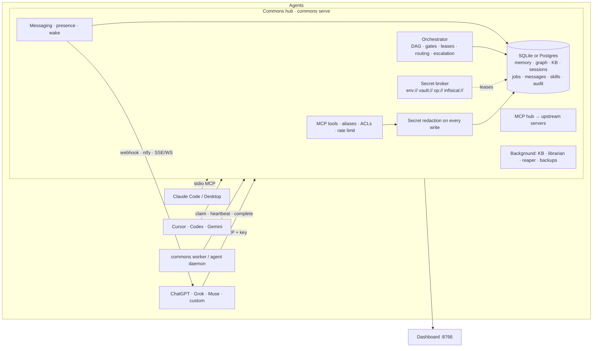

## Connect any AI
**One command per AI.** On the machine where the AI runs:

```bash
pip install -U commons-memory && commons setup --client claude-code --agent my-agent --url http://HUB:8770
```

It asks for the agent's key once (hidden, saved 0600), then does every step, each on by default:
- connects the AI to Commons over MCP;
- installs the master instructions it always loads (`CLAUDE.md` plus a `commons` skill, `AGENTS.md`, `GEMINI.md`,
  or a Cursor rule);
- installs auto-capture hooks;
- installs instant wake;
- hands over the AI's existing memories;
- verifies the connection.

Add `--no-<step>` to leave one out. The dashboard's Connect page builds this command with a checkbox per step.
Clients: `claude-code`, `codex`, `gemini`, `cursor`, `opencode`, `copilot`, `cline`, `kilo`, `amp`, `factory`, `qwen`, `crush`, `goose`, `windsurf`, `zed`, `roo`, `warp`.

**Hosted chat apps** (claude.ai, ChatGPT, Grok, Muse) can't run commands: paste [PROMPT.md](PROMPT.md) into their
custom instructions. It is generated from the same master instructions, so it never goes stale, and Commons hands
every agent the same playbook on its first check-in and whenever it changes.

## Screenshots
Captured from a demo hub (`python scripts/demo_seed.py demo.db`): made-up agents, jobs and memories.

| | |
|---|---|
| 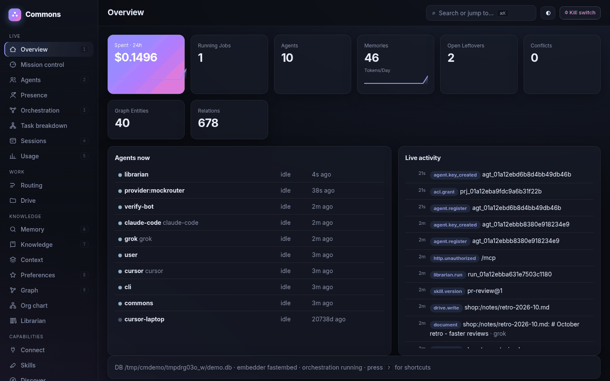<br>**Overview**: what needs you first (one-tap answers, approvals), then spend, running jobs, the team and activity | 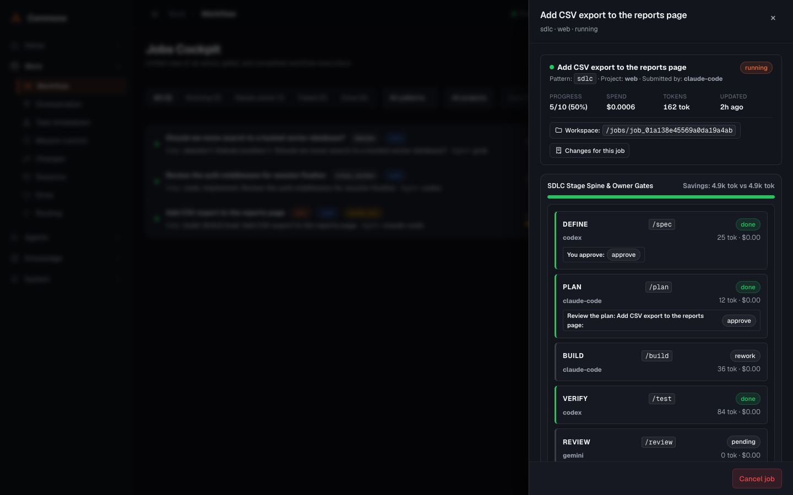<br>**Jobs**: every job with live filters; a job opens in a drawer with its stage spine, steps, routing and owner actions |
| 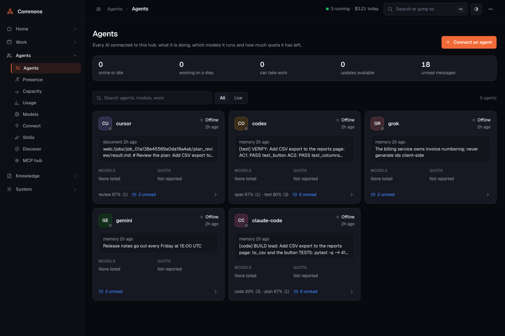<br>**Agents**: the fleet, what each is doing, its models, quota and tool version; click for the agent drawer | 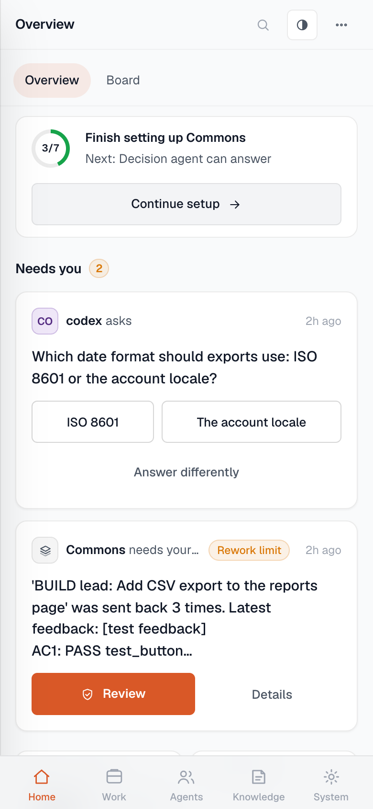<br>**On a phone**: every page works at 390 px, with a bottom bar and sub-tabs |
| 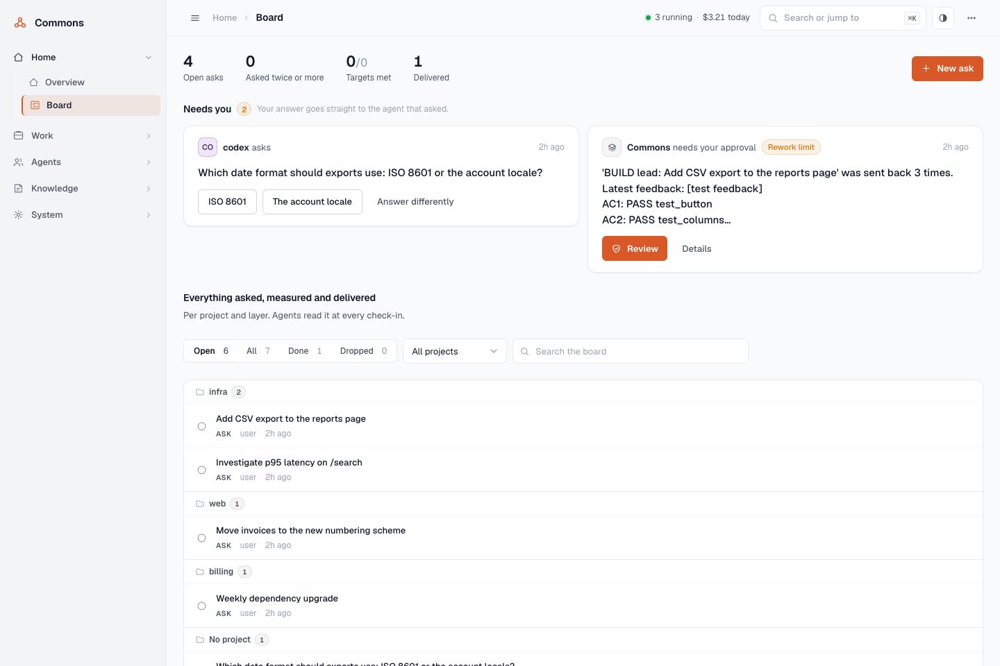<br>**Board** (light theme): what you asked, targets and deliveries, with one-click Done and Undo | 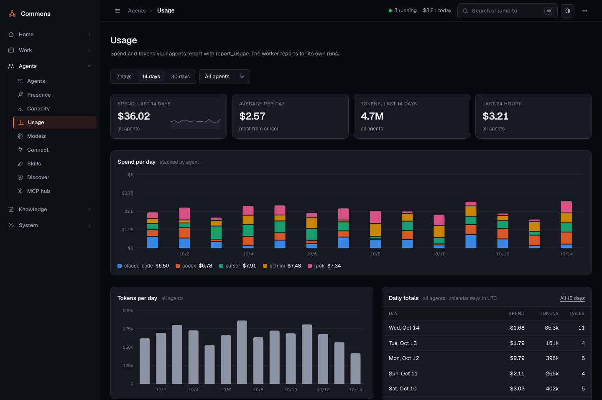<br>**Usage**: spend and tokens per day by agent, 7 to 30 days |
| 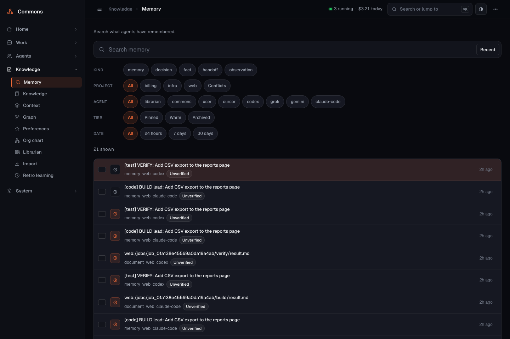<br>**Memory**: search first, filter chips, drawers, bulk actions | 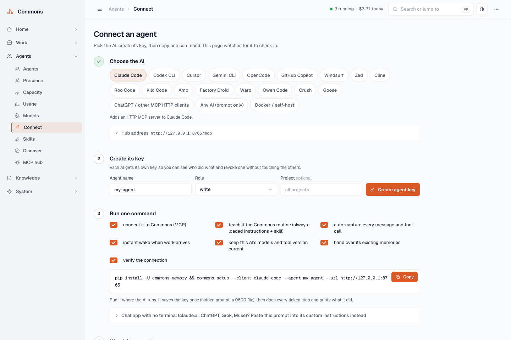<br>**Connect an agent**: pick the AI, create its key, one command, watch it connect |
| 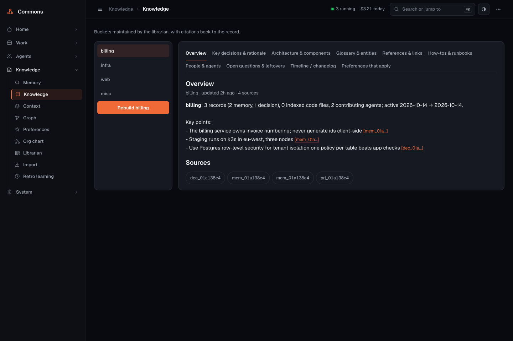<br>**Knowledge**: an auto-built, cited knowledge base per project | 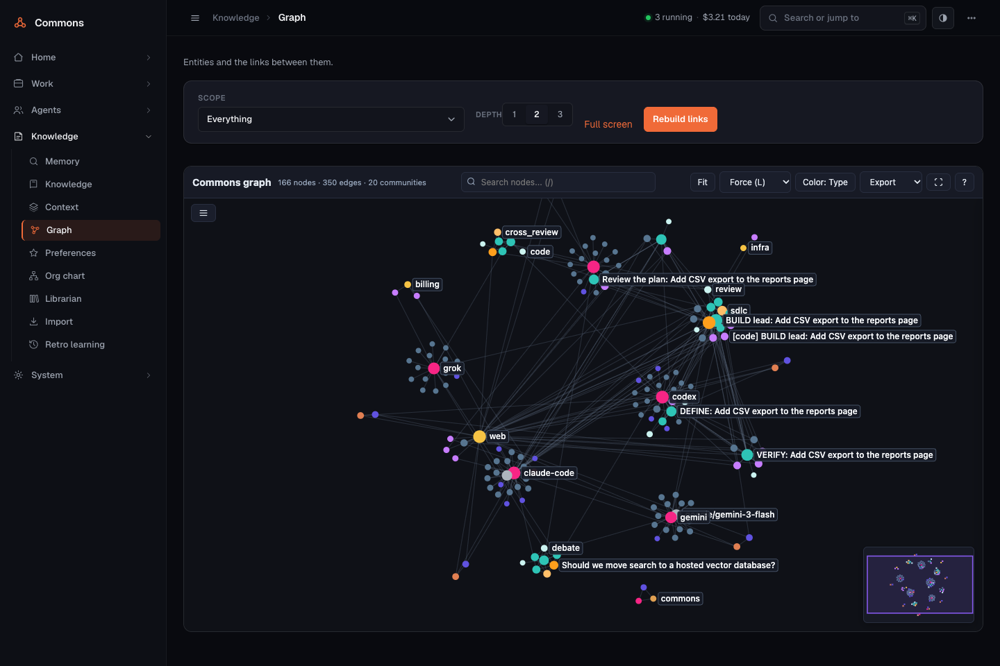<br>**Graph**: memory, code, sessions and agents in one graph |
| 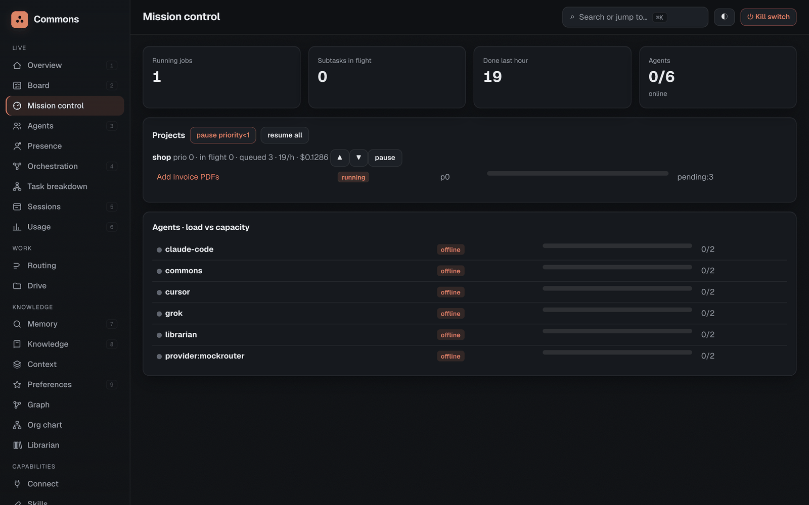<br>**Mission control**: fair-share scheduling and agent load against capacity | |

## Multi-agent in 5 commands
```sh
commons serve --transport http --host <tailnet-ip> --port 8770 --dashboard     # 1. the hub (keys required)
commons connect grok --expertise code:0.9,review:0.7                           # 2. each agent gets a key + profile
commons connect muse --expertise writing:0.9,review:0.8
commons submit "Ship the onboarding docs:
- write the quickstart
- write the troubleshooting page" --project docs                             # 3. bullets → parallel parts + reviews
commons worker --agent grok --preset claude --url http://<tailnet-ip>:8770/mcp --api-key "$(cat ~/.commons/agents/grok.key)" &   # 4. headless seats
commons status                                                                  # 5. or the dashboard's Mission control
```
Interactive AIs claim the same subtasks with `pickup` → `claim_subtask` → `complete_subtask`. Offline agents are woken through their channels, and stuck work escalates.

## Security model
- **Identity.** HTTP requires an agent key or OAuth 2.1 token on every request (`401` otherwise). Only key hashes are stored. Each principal is rate-limited (`429`, `COMMONS_RATE_PER_MIN`).
- **Access control.** Per-project ACLs (`commons acl grant PROJECT AGENT --role read|write|admin`). The sole author of a project can make it private. Trust scores weight search and the KB.
- **No raw secrets in memory.** Every write passes a gitleaks-style and entropy redactor. Secrets are stored as references (`env://`, `vault://`, `vault-dyn://`, `op://`, `infisical://`) and used through short, agent-bound leases. `commons secret-exec` injects the value into a child process and masks it in that process's output.
- **Tools.** The MCP hub applies allow/deny/approve policies per agent and tool. Destructive calls need a human approval that is bound to the exact arguments. Upstream output is fenced as untrusted, and so is anything a stranger can write on a watched GitHub repo (issue and PR text, branch names, commit messages): it never reaches a job title, and issues and PRs from people outside the repo make no job unless you turn on `github_outside`.
- **Owner proof.** The tokenless LAN dashboard can't tell you from an agent on the same network, so anything that could approve an agent's own request or reach a key (approvals, providers, settings, the vault, MCP policy, trust, routing, new agent keys) needs your owner password once one is set. You choose it on your first visit: for 30 minutes after Commons starts, the dashboard offers "Make this hub yours" to whoever opens it, from any browser, with no code (a restart reopens the window until a password exists; every claim notifies you; `COMMONS_CLAIM_MINUTES=0` means setup-code only). Each browser then stays signed in for 14 days. Want the whole dashboard behind it? Switch on `dashboard_lock` on Setup. Model providers, role models and resuming after the kill switch need an admin over MCP too.
- **Review gates.** Skills and gated subtasks need a *different* agent (or you) to approve. Kill switch, daily cost cap and per-job budgets.
- **Network.** Bind to loopback or a private network (below). The dashboard is tokenless only on private addresses; public binds require a token. Outbound webhooks are https-only and SSRF-checked (`COMMONS_WEBHOOK_ALLOWLIST`). Audit log for secrets, ACLs, approvals and escalations.
- Encryption at rest: SQLCipher (`COMMONS_DB_KEY`) or disk encryption. Known gaps are tracked honestly in [FLAWS_AND_GAPS.md](FLAWS_AND_GAPS.md).

## Networking
- **One machine:** stdio MCP. Nothing listens on the network.
- **Several machines (recommended): your tailnet / VPN.** `commons serve --transport http --host <tailscale-ip> --port 8770 --dashboard`. The dashboard follows `--host`. On localhost, LAN (RFC 1918) and tailnet (100.64.0.0/10) addresses it needs **no token**. Binding it to a public address requires `COMMONS_DASHBOARD_TOKEN`. Set `COMMONS_DASHBOARD_REQUIRE_TOKEN=1` to demand a token everywhere.
- **Don't bind `0.0.0.0`** unless the host has no public interface. Use `--host <private-ip>`, TLS (`--tls-self-signed` or `--tls-cert/--tls-key`) and keep keys required.
- **From anywhere:** `commons expose up tailscale|cloudflare|ngrok|ssh|…`. It refuses public exposure unless keys are enforced. Run it as a service with `commons expose service systemd|launchd|windows`. Details: [docs/networking.md](docs/networking.md).
- **Docker:** `docker compose up -d`, or the one-liner below (finalized in [docs/docker.md](docs/docker.md)):
  ```sh
  docker run -d --name commons -p 8770:8770 -p 8766:8766 -v commons-data:/data ghcr.io/neoo-blue/commons-memory:latest   # placeholder, see docs/docker.md
  ```

## Configuration
Everything works with defaults. These are the settings people usually change:

| Variable | Default | Purpose |
|---|---|---|
| `COMMONS_DB` | `~/.commons/commons.db` | SQLite path or `postgresql://…` |
| `COMMONS_REQUIRE_KEYS` | `1` | HTTP requires keys (`0` = local dev only) |
| `COMMONS_DASHBOARD_TOKEN` | — | Dashboard admin token; required only on public addresses |
| `COMMONS_DASHBOARD_REQUIRE_TOKEN` | — | `1` = require the token even on localhost/LAN/tailnet |
| `COMMONS_RATE_PER_MIN` | `600` | Per-agent HTTP rate limit |
| `COMMONS_ADMIN_AGENTS` | — | Agents with global admin rights |
| `COMMONS_EMBEDDER` | `hash` | `fastembed` for real embeddings |
| `COMMONS_DAILY_COST_CAP` | — | USD/day cap for orchestrated work |
| `COMMONS_ESCALATE_AFTER` | `900` | Seconds before stuck work escalates |
| `COMMONS_LEASE_SECONDS` | `900` | Subtask lease length |
| `COMMONS_WEBHOOK_ALLOWLIST` | — | Private or non-https wake/webhook hosts you trust |
| `COMMONS_DB_KEY` | — | SQLCipher encryption key (as a secret ref) |
| `COMMONS_BACKGROUND` | `light` | In-process maintenance (`full`, `0`) |

**All 89 variables** are in [docs/configuration.md](docs/configuration.md). It's generated from the code by `scripts/gen_env_reference.py`, and a test fails if a setting is undocumented.

## Troubleshooting
| Symptom | Fix |
|---|---|
| `address already in use` | Another service owns the port. Use `--port 8770` (and update client URLs). |
| `401 Unauthorized` | Send `Authorization: Bearer <agent key>`. Keys live in `~/.commons/agents/<name>.key`, and `commons connect NAME` re-keys. |
| `429 Too Many Requests` | Respect `Retry-After`, or raise `COMMONS_RATE_PER_MIN`. |
| Dashboard unreachable from another machine | Bind it to that interface (`--host` / `--dashboard-host`). On LAN/tailnet no token is needed. On a public address, set `COMMONS_DASHBOARD_TOKEN` and open `http://<host>:8766/?token=…` |
| Agent shows *offline* / never gets work | Make an authenticated call or `commons agent daemon`. Add a wake channel with `commons wake add AGENT webhook url=…` |
| Subtask stuck in `claimed` | The worker died. The lease expires (`COMMONS_LEASE_SECONDS`), then the subtask is reassigned to another agent. Run `commons escalate` to force it. |
| `skill … has no approved version` | Another agent (or you) must `skill_review` it. Authors can't self-approve. |
| `admin rights required` | Be a project admin, be listed in `COMMONS_ADMIN_AGENTS`, or be the project's sole author. |
| `commons: command not found` after install | Add `~/.local/bin` to `PATH` (Windows: `%USERPROFILE%\.local\bin`). |
| Unknown-argument error from a tool | The error lists the accepted names and aliases. |

## FAQ
- **Do I need a server?** No. A single machine uses stdio and one SQLite file. Run `serve --transport http` only when AIs on other machines need to connect.
- **Which AIs work?** Anything that speaks MCP (stdio or streamable HTTP). Others can use the HTTP `/bus/*` and `/agent/*` endpoints or a CLI worker.
- **Will it leak my secrets to models?** Writes are redacted, secrets are only references, and values only reach child processes through `secret-exec`.
- **What does it cost?** Commons itself makes no LLM calls unless you configure a planner, summarizer or providers. Usage reported by agents shows up on the dashboard.
- **Can I move from SQLite to Postgres?** Yes: `commons migrate-postgres postgresql://…`.
- **Can I stop it?** Yes. Run `commons pause` (kill switch). `commons dump` exports everything as JSONL.

## Benchmarks (v0.9.0; LongMemEval QA on v0.20, tool sizes on v0.23)
Measured on an 8-core Apple M1 laptop that was busy with other jobs, CPU only. Full tables, caveats and per-question
results are in [benchmarks/README.md](benchmarks/README.md); every number is reproducible with `commons bench`.

| What | Metric | Commons |
|---|---|---|
| LoCoMo retrieval, 1,982 questions | evidence-turn any@1 / @10 | **39.4% / 76.5%** (v0.8: 31.2 / 71.1); reproduced on v0.21.1, [results](benchmarks/results/v0.21.1/) |
| LoCoMo retrieval | evidence-session any@10 | **97.4%** (v0.8: 95.8) |
| LoCoMo end-to-end QA, 1,540 questions (cat 1-4) | LLM-judged accuracy, Haiku 4.5 reader + judge, k=20 | **78.8%** with `context=2` and date resolution (69.5% for hits alone); no LLM at write time |
| LongMemEval-S end-to-end QA, seeded 100 questions | same reader, judge and k | **67%** on v0.20.1 (v0.9: 62%); temporal 63% (v0.9: 53%). Hits alone: on its long sessions neighbouring turns cost 7 to 10 points (1 turn each side 60%, 2 turns 57%), nearly all in temporal reasoning (63% → 40% → 30%), so Commons hands the reader the hits, dated |
| Search latency, 30k / 60k memories | p50 | **68 ms / 114 ms** (v0.8: 1,383 ms at 30k) |
| Tool schema an AI pays for each session | tokens, exact (Anthropic tokenizer) | **6,291** for the 31 core tools in v0.23; listing all 183 would cost 39,710 |
| Self-check on your own data (`commons bench self`) | known-item hit@1 / @5 | 93% / 100% on a 166-memory sample |

**Head-to-head, rivals run here on the same LoCoMo data** (details in [benchmarks/README.md](benchmarks/README.md)):

| vs | Same metric | Commons | Rival |
|---|---|---|---|
| mem0 OSS | QA accuracy, same reader/judge/prompts, 1,540 q | **78.8%** | 70.3% (paired: Commons alone right 232x, mem0 alone 107x, p = 1e-11) |
| mem0 OSS | per category: multi-hop / temporal / inference / single-hop | **64.2 / 77.3 / 43.8 / 88.2** | 61.0 / 73.8 / 37.5 / 76.2 |
| mem0 OSS | search p50 / LLM calls per write | **24-68 ms / none** | 377 ms / extraction on every write |
| MemPalace | its own recall metric, dialog / session top-10 | **0.708 / 0.945** | 0.545 / 0.889 |
| claude-mem 13.36 | same metric, dialog / session top-10 | **0.708 / 0.945** | 0.496 / 0.811 (search p50 2.7 s) |
| claude-mem 13.36 | footprint at rest | **43 MB RSS, 0.1% CPU** with 5,761 memories (185 MB once the embedder loads) | its chroma-mcp process sat at ~39% CPU on the same Mac |

Published numbers elsewhere use other readers, judges and subsets (mem0's paper: 66.9% with gpt-4o-mini; its
managed platform and Zep claim 92-95% under their own setups), so only the table above is apples to apples.

## Comparison
| Project | Great at | Commons' angle |
|---|---|---|
| [mem0 / OpenMemory](https://github.com/mem0ai/mem0) | Fact extraction, cross-client memory | Higher LoCoMo QA in every category (78.8% vs 70.3%, same reader and judge) with no LLM on the write path, plus a code graph, handoffs, a project board, orchestration and secrets; `commons import mem0` brings your memories over |
| [claude-mem](https://github.com/thedotmack/claude-mem) | Automatic capture across 8+ agent harnesses | The same capture shared by every agent, plus orchestration, a vault, a board and a job workspace; `commons import claude-mem --curate` imports and cleans its history |
| [MemPalace](https://github.com/MemPalace/mempalace) | Verbatim recall, retrieval benchmarks, logstream task coordination | Higher LoCoMo recall under MemPalace's own metric (0.708 vs 0.545 dialog-level); both coordinate agents (claims, diffs, wake), and Commons adds model-planned work splitting, a credential vault, a project board, row-level access and signed audit exports |
| [Archify](https://github.com/tt-a1i/archify) | Validated, interactive architecture diagrams | Diagrams come from the real code index and history: code graph with source links pinned to the indexed commit, call and multi-agent sequence diagrams, job workflows, lifecycle state machines with real transition counts, and an architecture diff between any two snapshots, plus communities, impact paths and a cluster map |
| [Graphiti / Zep](https://github.com/getzep/graphiti) | Temporal knowledge graph | Inspired Commons' conflict and supersede model |
| [Cognee](https://github.com/topoteretes/cognee) | Rich document graphs | Commons is a lighter single-file hub |
| [basic-memory](https://github.com/basicmachines-co/basic-memory) | Human-readable Markdown memory | Commons has Obsidian/Markdown export |
| [A2A](https://github.com/a2aproject/A2A) | Agent-to-agent protocol | Commons ships an A2A server and client |
| Agent buses / chat bridges | Messaging | Commons adds a shared mailbox, presence and wake, plus a bus-compatible shim |

## Roadmap
- First PyPI release (the publishing workflow is in place; `uvx commons-memory` / `pipx install commons-memory` work once it lands).
- Hosted dashboard auth via OIDC.

History: [CHANGELOG.md](CHANGELOG.md).

## Development
```sh
git clone https://github.com/Neoo-Blue/commons-memory && cd commons-memory
uv venv && uv pip install -e ".[dev,all]" && uv run pytest -q
python scripts/gen_env_reference.py      # after adding a COMMONS_* setting
```
MIT licensed.
